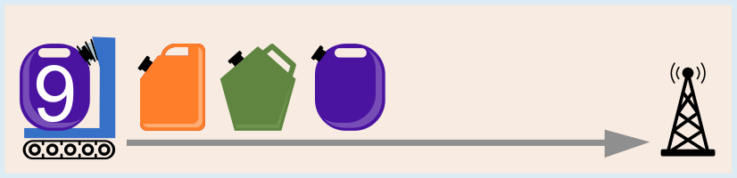
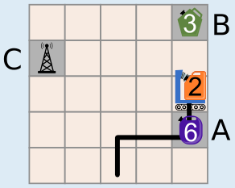
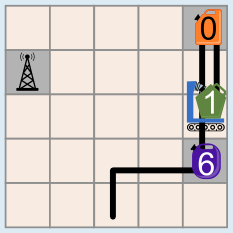
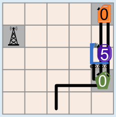
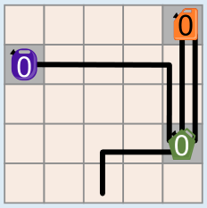
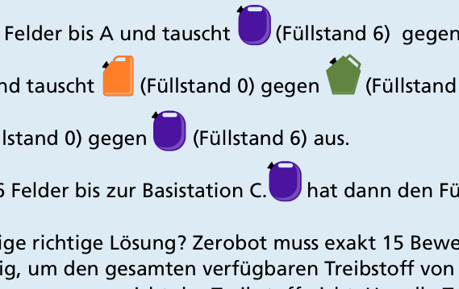

---
answers:
  - [up, right, right, up, up, up, down, down, down, up, up, left, left, left, left]
  - [up, right, right, up, up, up, down, down, down, up, left, up, left, left, left]
  - [up, right, right, up, up, up, down, down, down, up, left, left, up, left, left]
  - [up, right, right, up, up, up, down, down, down, up, left, left, left, up, left]
  - [up, right, right, up, up, up, down, down, down, up, left, left, left, left, up]
  - [up, right, right, up, up, up, down, down, down, left, up, up, left, left, left]
  - [up, right, right, up, up, up, down, down, down, left, up, left, up, left, left]
  - [up, right, right, up, up, up, down, down, down, left, up, left, left, up, left]
  - [up, right, right, up, up, up, down, down, down, left, up, left, left, left, up]
  - [up, right, right, up, up, up, down, down, down, left, left, up, up, left, left]
  - [up, right, right, up, up, up, down, down, down, left, left, up, left, up, left]
  - [up, right, right, up, up, up, down, down, down, left, left, up, left, left, up]
  - [up, right, right, up, up, up, down, down, down, left, left, left, up, up, left]
  - [up, right, right, up, up, up, down, down, down, left, left, left, up, left, up]
  - [up, right, right, up, up, up, down, down, down, left, left, left, left, up, up]
  - [right, up, right, up, up, up, down, down, down, up, up, left, left, left, left]
  - [right, up, right, up, up, up, down, down, down, up, left, up, left, left, left]
  - [right, up, right, up, up, up, down, down, down, up, left, left, up, left, left]
  - [right, up, right, up, up, up, down, down, down, up, left, left, left, up, left]
  - [right, up, right, up, up, up, down, down, down, up, left, left, left, left, up]
  - [right, up, right, up, up, up, down, down, down, left, up, up, left, left, left]
  - [right, up, right, up, up, up, down, down, down, left, up, left, up, left, left]
  - [right, up, right, up, up, up, down, down, down, left, up, left, left, up, left]
  - [right, up, right, up, up, up, down, down, down, left, up, left, left, left, up]
  - [right, up, right, up, up, up, down, down, down, left, left, up, up, left, left]
  - [right, up, right, up, up, up, down, down, down, left, left, up, left, up, left]
  - [right, up, right, up, up, up, down, down, down, left, left, up, left, left, up]
  - [right, up, right, up, up, up, down, down, down, left, left, left, up, up, left]
  - [right, up, right, up, up, up, down, down, down, left, left, left, up, left, up]
  - [right, up, right, up, up, up, down, down, down, left, left, left, left, up, up]
  - [right, right, up, up, up, up, down, down, down, up, up, left, left, left, left]
  - [right, right, up, up, up, up, down, down, down, up, left, up, left, left, left]
  - [right, right, up, up, up, up, down, down, down, up, left, left, up, left, left]
  - [right, right, up, up, up, up, down, down, down, up, left, left, left, up, left]
  - [right, right, up, up, up, up, down, down, down, up, left, left, left, left, up]
  - [right, right, up, up, up, up, down, down, down, left, up, up, left, left, left]
  - [right, right, up, up, up, up, down, down, down, left, up, left, up, left, left]
  - [right, right, up, up, up, up, down, down, down, left, up, left, left, up, left]
  - [right, right, up, up, up, up, down, down, down, left, up, left, left, left, up]
  - [right, right, up, up, up, up, down, down, down, left, left, up, up, left, left]
  - [right, right, up, up, up, up, down, down, down, left, left, up, left, up, left]
  - [right, right, up, up, up, up, down, down, down, left, left, up, left, left, up]
  - [right, right, up, up, up, up, down, down, down, left, left, left, up, up, left]
  - [right, right, up, up, up, up, down, down, down, left, left, left, up, left, up]
  - [right, right, up, up, up, up, down, down, down, left, left, left, left, up, up]
---
Zerobot kann mit 15 Bewegungen so zur Basisstation fahren, dass am Ende alle Tanks Füllstand 0 haben:

   

Um die richtige Antwort leichter erklären zu können, bezeichnen wir die Felder mit den Austauschtanks und der Basisstation mit den Buchstaben A, B und C. A ist das Feld mit dem Austauschtank in der vierten Zeile, B das Feld in der ersten Zeile und C die Basisstation.

Zerobot fährt 3 Felder bis A und tauscht seinen Tank (Füllstand 6) gegen den Tank mit Füllstand 3 aus. Dann fährt er 3 Felder bis B und tauscht seinen Tank (Füllstand 0) gegen den Tank mit Füllstand 3 aus. Damit fährt er wieder zu A und tauscht seinen Tank (Füllstand 0) gegen den Tank mit Füllstand 6 aus. Damit fährt er 6 Felder bis zur Basisstation C. Sein Tank hat dann den Füllstand 0. Mission erfüllt!

Ist dies die einzige richtige Lösung? Zerobot muss exakt 15 Bewegungen machen: 15 Bewegungen sind mindestens nötig, um den gesamten verfügbaren Treibstoff von 9 + 3 + 3 = 15 Einheiten zu verbrauchen, und für mehr Bewegungen reicht der Treibstoff nicht. Um alle Tanks zu leeren, muss er beide Felder mit Austauschtanks besuchen, und A sogar zweimal. Wenn Zerobot zuerst das Feld B besuchen würde, bräuchte er 17 Bewegungen, um die Basisstation zu erreichen, was nicht möglich ist. Somit ist die gezeigte Reihenfolge der Tanks die einzige richtige Antwort. (Der genaue Weg zwischen den Feldern darf sich ändern, nicht aber die Reihenfolge A, B, A, C. Darum akzeptiert die Prüfung alle 45 Wege dieser Art.)

## Das ist Informatik!

In dieser Biberaufgabe werden einige grundsätzliche Probleme der autonomen Mobilität angesprochen: Jeder autonome mobile Roboter (wie z. B. ein selbstfahrendes Auto) muss beachten, wie viel Energie in Form von Treibstoff oder Batterieladung zur Verfügung steht, wenn er seine Aktivitäten plant. Auf der einen Seite muss er sicherstellen, dass er rechtzeitig eine Ladestation oder Tankstelle erreicht, bevor sein Energievorrat verbraucht ist. Auf der anderen Seite gibt es Rahmenbedingungen zu beachten. In der Aufgabe ist eine Rahmenbedingung, dass am Ende der Energievorrat komplett verbraucht sein musste. In der Wirklichkeit hat man es vor allem mit anderen Rahmenbedingungen zu tun, wie z. B. die Position und Verfügbarkeit von Ladestationen. Die Software zur Steuerung mobiler Roboter enthält Komponenten, die für die Sicherstellung ausreichender Energie durch Nachladen sorgen (intelligentes Batterieladungsmanagement).

Darüber hinaus werden Computerprogramme auch zur Planung und Verwaltung effizienter Netze von Ladestationen verwendet. Informatikerinnen und Informatiker forschen an Lösungen zum *charging station placement problem*: Ladestationen für mobile Roboter müssen so platziert werden, dass ein Roboter mit einem gewissen Mindestladestand eine der verfügbaren Ladestationen erreichen kann. Für die Kommunikation zwischen Ladestationen und selbstfahrenden Autos wurden Protokolle entwickelt wie z. B. das OCPP (Open Charge Point Protocol).
