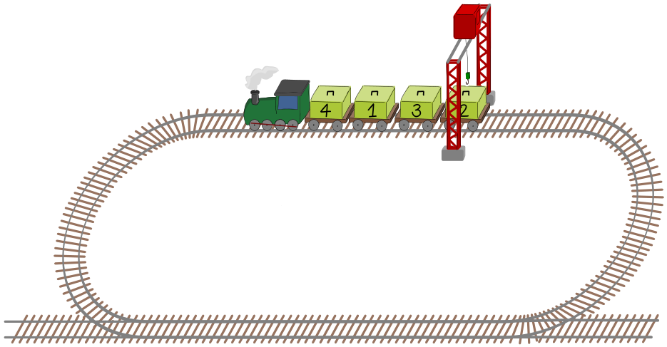
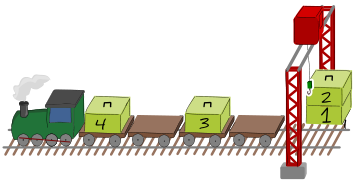
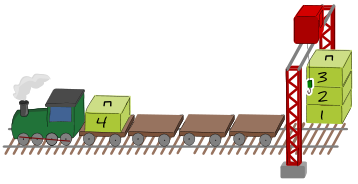
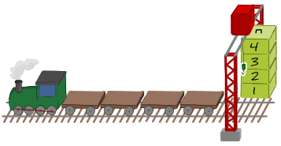
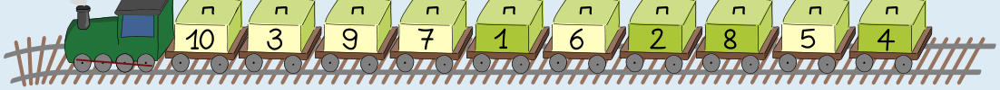

Ein Zug hat Wagen mit nummerierten Kisten. Zum Entladen der Kisten fährt der Zug eine Runde zum Kran. Der Kran ist unbeweglich, und der Zug kann nur vorwärts fahren.

Die Kisten sollen in der Reihenfolge ihrer Nummern entladen werden, Kiste 1 zuerst.

Der Zug fährt Wagen für Wagen die Kisten unter den Kran. Nur wenn eine Kiste an der Reihe ist, entlädt der Kran die Kiste. Wenn der Zug unter dem Kran durch ist, können noch Kisten auf den Wagen sein. Dann muss der Zug noch eine Runde zum Kran fahren.

Der obige Zug muss drei Runden fahren, bis alle Kisten in der richtigen Reihenfolge entladen sind:

| Runde 1 | Runde 2 | Runde 3 |
|---|---|---|
|  |  |  |
| Kiste 4 ist nicht an der Reihe, Kiste 1 wird entladen, Kiste 3 ist nicht an der Reihe, Kiste 2 wird entladen. | Kiste 4 ist nicht an der Reihe, Kiste 3 wird entladen. | Kiste 4 wird entladen. |

Nun hat ein anderer Zug zehn Wagen. Die Kisten stehen auf dem Zug in dieser Reihenfolge (von der Lokomotive aus gesehen): 10, 3, 9, 7, 1, 6, 2, 8, 5, 4.

**Wie viele Runden muss dieser Zug fahren, bis alle Kisten in der richtigen Reihenfolge entladen sind?**
