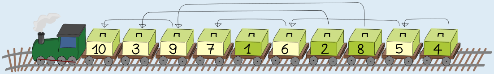

**7** ist die richtige Antwort.

Die richtige Reihenfolge für das Entladen ist 1, 2, 3, 4, 5, 6, 7, 8, 9, 10; die Reihenfolge der Kisten auf dem Zug ist aber 10, 3, 9, 7, 1, 6, 2, 8, 5, 4. Nach der ersten Runde kann der Kran die Kisten 1 und 2 entladen. Nach der zweiten Runde kann der Kran die Kisten 3 und 4 entladen, nach weiteren Runden dann die Kisten 5, 6, 7 und 8, 9 und schließlich 10. Insgesamt fährt der Zug 7 Runden.

Zur Beantwortung kann man sich auch Folgendes überlegen: Der Zug muss immer dann eine weitere Runde fahren, wenn zwei in der richtigen Reihenfolge direkt hintereinander stehende Kisten auf dem Zug falsch herum stehen, also die Kiste mit der größeren Nummer vor der Kiste mit der kleineren Nummer kommt.

Da z. B. Kiste 3 vor Kiste 2 kommt, ist Kiste 3 nach der ersten Runde nicht an der Reihe und kann nicht entladen werden. Der Zug muss eine weitere Runde fahren, damit auch Kiste 3 entladen werden kann. Für das Nummernpaar (2,3) stehen also die Kisten „falsch“ auf dem Zug. Beim gegebenen Zug gibt es sechs solcher Paare: (2,3), (4,5), (5,6), (6,7), (8,9) und (9,10). Deshalb muss der Zug 6 zusätzliche Runden fahren, also insgesamt 7 Runden.

## Das ist Informatik!

Wenn für eine beliebige Zahl in der Folge 1, 2, 3, 4, 5, 6, 7, 8, 9, 10 die Kiste mit der nächstgrößeren Zahl weiter vorne auf dem Zug liegt, sprechen Informatikerinnen und Informatiker von einer *Inversion*, das bedeutet Umkehrung. Für jede solche Umkehrung ist eine zusätzliche Runde erforderlich. Wenn wir die Anzahl der Umkehrungen zählen, erhalten wir die richtige Antwort zu dieser Biberaufgabe.

Das Zählen von Inversionen in Bezug auf eine gewünschte Folge hat viele Anwendungen. Bei einigen Sortieralgorithmen, wie z. B. Bubble-Sort, gibt die Anzahl der Inversionen Aufschluss darüber, wie viele Vertauschungen erforderlich sind, um eine bestimmte Folge zu sortieren. Wenn zwei Kunden dieselbe Menge von Artikeln in eine Rangfolge bringen, sagt uns die Anzahl der Inversionen in ihren Ranglisten, wie sehr sich ihre Vorlieben gleichen. Dies wird von Online-Shops genutzt, um „ähnliche“ Kunden zu identifizieren und ihnen Produktempfehlungen zu geben.
