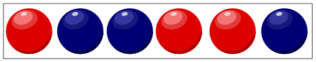

Emil beschreibt Folgen von blauen und roten Bällen nur mit 0en und 1en. Das macht er auf ganz besondere Weise und zeigt das an einem Beispiel:

Im ersten Schritt zählt Emil für jeden Ball, wie viele **blaue** Bälle sich rechts davon befinden, und zählt den Ball selbst mit, wenn der blau ist. Diese Anzahlen schreibt er als Zwischenfolge auf: `3, 3, 2, 1, 1, 1`

Im zweiten und letzten Schritt formt er die Zwischenfolge so um: Wenn die Zahl **gerade** ist, wird sie zu `0`, wenn sie **ungerade** ist, zu `1`. `0` gilt als gerade Zahl. Emil beschreibt die obige Bälle-Folge also so: `1, 1, 0, 1, 1, 1`

Eine andere Bälle-Folge beschreibt Emil so: `0, 1, 1, 1, 0, 1, 0, 0`

**Erstelle diese Bälle-Folge!**

Ziehe dazu rote und blaue Bälle in die acht Felder.
