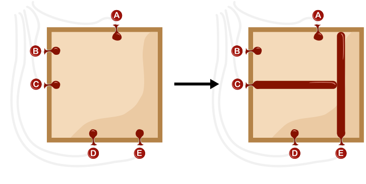
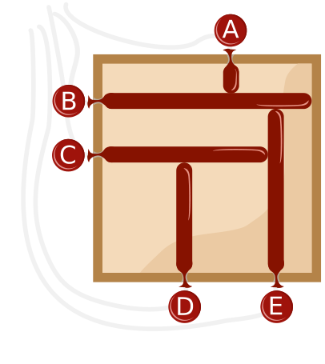

Eine Ballonmaschine kann Bilder erstellen, indem sie Ballons in einem quadratischen Rahmen aufbläst. Die Ballons sind mit den Buchstaben A, B, C, D und E beschriftet. Die Maschine liest nacheinander eine Folge von Buchstaben, von links nach rechts. Vor dem ersten Buchstaben sind alle Ballons leer.

Wenn die Maschine einen Buchstaben gelesen hat, macht sie Folgendes: Der Ballon mit diesem Buchstaben wird aufgeblasen, bis er

- entweder einen anderen Ballon berührt
- oder den gegenüberliegenden Rand des Rahmens berührt.

Wenn die Maschine zum Beispiel die Buchstabenfolge E C liest, macht sie dies:

Die Maschine liest eine Folge von fünf Buchstaben. Am Ende hat sie dieses Bild erstellt.

**Gib die Folge an!**
