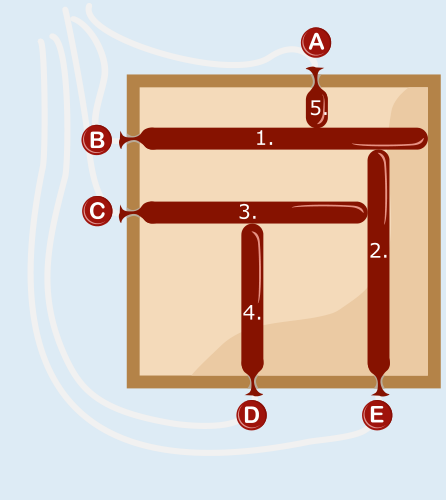

---
answers:
  - [b, a, e, c, d]
  - [b, e, a, c, d]
  - [b, e, c, a, d]
  - [b, e, c, d, a]
---
Aus dem Bild, das die Maschine erstellt hat, kann man einige Bedingungen für die richtige Reihenfolge beim Aufblasen der Ballons ablesen. Denn außer Ballon B wurde jeder Ballon aufgeblasen, bis er einen anderen Ballon berührt hat:

- Ballon B wurde vor A und E aufgeblasen.
- E wurde vor C aufgeblasen.
- C wurde vor D aufgeblasen.

Diese „Vorrangbeziehungen“ kann man als Pfeile zeichnen: Ein Pfeil von B zu A gibt an, dass Ballon B vor Ballon A aufgeblasen werden muss.

Jede richtige Antwort muss diese Vorrangbeziehungen einhalten. Das heißt, dass bei jeder richtigen Antwort am Anfang B sein muss. Zudem muss E vor C und C vor D sein. Das A kann jedoch irgendwann nach dem B kommen. Damit kann es genau vier mögliche richtige Folgen geben:

- B A E C D
- B E A C D
- B E C A D
- B E C D A

Hier sieht man, wie die Maschine mit der letzten Folge das gewünschte Bild erstellt:

## Das ist Informatik!

Die Buchstabenfolge ist wie ein Programm, das die Ballonmaschine steuert. Jeder Buchstabe ist eine Anweisung, die die Maschine dazu bringt, einen Ballon aufzublasen. Die „Buchstaben-Anweisungen“ können zu einer Anweisungsfolge kombiniert werden. So entsteht ein längeres Programm, mit dem die Maschine komplexere Bilder erstellen kann. Dabei ist die Reihenfolge der Anweisungen wichtig. Zum Beispiel erzeugt die Anweisungsfolge B E ein anderes Bild als die Anweisungsfolge E B. Das liegt daran, dass die Ausführung einer Anweisung Auswirkungen auf die Ausführung folgender Anweisungen haben kann. Bei der Ballonmaschine hat die Ausführung einer Anweisung insbesondere Auswirkungen auf die Länge der später aufgeblasenen Ballons.

Auch Computerprogramme bestehen aus Anweisungen, die zu größeren Programmen kombiniert werden. Die einfachste Form der Kombination nennt man in der Informatik eine Sequenz, also eine Folge von Anweisungen. Kompliziertere Kombinationen entstehen durch spezielle Kontrollstrukturen wie Wiederholungsanweisungen und bedingte Anweisungen. Auch bei Computerprogrammen kann das Ausführen einer Anweisung Auswirkungen auf die spätere Ausführung einer anderen Anweisung haben – zum Beispiel, wenn beide Anweisungen auf die gleichen Daten zurückgreifen und diese verändern. Es ist eine wichtige Aufgabe für Informatikerinnen und Informatiker, bei der Entwicklung von Programmen solche Auswirkungen sorgfältig zu beachten, damit die Programme so funktionieren wie gewünscht. So wie bei der Ballonmaschine in dieser Biberaufgabe die Reihenfolge der Anweisungen stimmen muss, damit die Maschine das gewünschte Bild erstellt.
