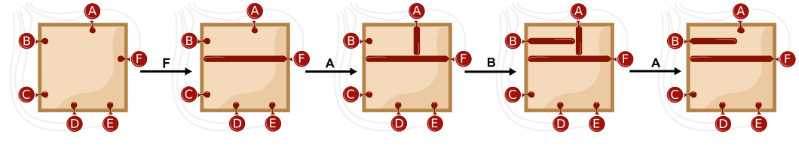
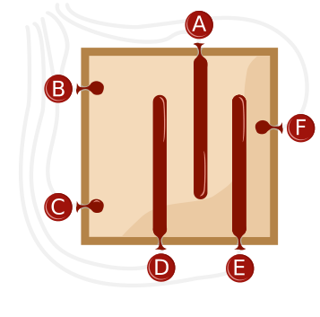

Eine Ballonmaschine kann Bilder erstellen, indem sie Ballons in einem quadratischen Rahmen aufbläst.

Die Ballons sind mit den Buchstaben A, B, C, D, E und F beschriftet.

Die Maschine liest nacheinander eine Folge von Buchstaben, von links nach rechts. Vor dem ersten Buchstaben sind alle Ballons leer.

Wenn die Maschine einen Buchstaben gelesen hat, macht sie Folgendes:

- Wenn der Ballon mit diesem Buchstaben leer ist, wird er aufgeblasen, bis er entweder einen anderen Ballon oder den gegenüberliegenden Rand des Rahmens berührt.
- Wenn der Ballon mit diesem Buchstaben aufgeblasen ist, wird er entleert.

Wenn die Maschine zum Beispiel die Buchstabenfolge F A B A liest, macht sie dies:

Die Maschine liest eine Folge von neun Buchstaben. Am Ende hat sie dieses Bild erstellt.

**Gib die Folge an!**
