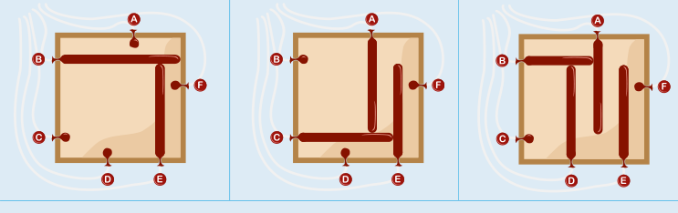

---
answers:
  - [b, e, b, c, a, c, b, d, b]
  - [b, e, c, b, a, c, b, d, b]
  - [b, e, b, c, a, b, c, d, b]
  - [b, e, c, b, a, b, c, d, b]
---
Für die Folge der Buchstaben, die die Maschine liest (ab jetzt: Lesefolge), lassen sich einige Bedingungen feststellen:

1. Damit der Ballon von E (wir sagen ab jetzt kurz: Ballon E) eine Länge wie im Ergebnis erreicht, muss zuerst B und dann E aufgeblasen werden. Irgendwann später muss B wieder entleert werden. Die Lesefolge muss also B E B als Teil enthalten. (Ein solcher Teil kann durch andere Buchstaben unterbrochen werden.)
2. Die obige Feststellung für Ballon E gilt auch für Ballon D. Die Lesefolge muss also auch B D B als Teil enthalten.
3. Damit Ballon A eine Länge wie im Ergebnis erreicht, muss zuerst C und dann A aufgeblasen werden. Irgendwann später muss C wieder entleert werden. C A C ist also ein weiterer Teil der Lesefolge.
4. B muss entleert sein, bevor A aufgeblasen wird.
5. C muss entleert sein, bevor D aufgeblasen wird.
6. Wenn B für Ballon E aufgeblasen wird, muss A entleert sein – wie zu Beginn.
7. Damit am Ende A, D und E aufgeblasen sind, dürfen diese Buchstaben nur einmal vorkommen (oder dreimal, oder fünfmal, … – aber die Folge darf ja nur insgesamt neun Buchstaben haben). Wegen der Bedingungen 4 bis 6 muss E A D ein Teil der Lesefolge sein.

Hier ist eine Lesefolge, die alle Bedingungen erfüllt: B E B C A C B D B. Wir zeigen die Situationen nach B E, nach B E B C A und vor dem letzten B:



Durch die Bedingungen ist die Lesefolge nicht komplett festgelegt. In der obigen Folge ist an genau zwei Stellen die Reihenfolge nicht durch die Bedingungen vorgegeben: B E B C A C B D B. Insgesamt gibt es also vier richtige Lesefolgen:

- B E B C A C B D B
- B E C B A C B D B
- B E B C A B C D B
- B E C B A B C D B

## Das ist Informatik!

Die Lesefolge ist wie ein Programm, das die Ballonmaschine steuert. Jeder Buchstabe ist eine Anweisung, die die Maschine dazu bringt, einen Ballon aufzublasen oder zu entleeren. Die „Buchstaben-Anweisungen“ können zu einer Anweisungsfolge kombiniert werden. So entsteht ein längeres Programm, mit dem die Maschine komplexere Bilder erstellen kann. Dabei ist die Reihenfolge der Anweisungen wichtig. Zum Beispiel erzeugt die Anweisungsfolge B E ein anderes Bild als die Anweisungsfolge E B. Das liegt daran, dass die Ausführung einer Anweisung Auswirkungen auf die Ausführung folgender Anweisungen haben kann. Bei der Ballonmaschine hat die Ausführung einer Anweisung insbesondere Auswirkungen auf die Länge der später aufgeblasenen Ballons.

Auch Computerprogramme bestehen aus Anweisungen, die zu größeren Programmen kombiniert werden. Die einfachste Form der Kombination nennt man in der Informatik eine Sequenz, also eine Folge von Anweisungen. Kompliziertere Kombinationen entstehen durch spezielle Kontrollstrukturen wie Wiederholungsanweisungen und bedingte Anweisungen. Jede „Buchstaben-Anweisung“ der Ballonmaschine in dieser Biberaufgabe ist eine bedingte Anweisung. Im Stil einer Computer-Programmiersprache kann man diese Anweisung so formulieren – unter der Annahme, dass ein Ballon nur zwei Zustände haben kann (leer und nicht leer bzw. aufgeblasen):

```
Wenn der Ballon zu diesem Buchstaben leer ist, dann:
    Blase den Ballon auf, bis …
Sonst:
    Entleere den Ballon.
```

Es ist eine wichtige Aufgabe für Informatikerinnen und Informatiker, bei der Entwicklung von Programmen die Auswirkungen von Anweisungen sorgfältig zu beachten, damit die Programme so funktionieren wie gewünscht. Bei bedingten Anweisungen ist das besonders schwierig, da deren Ausführung von der Auswertung der in der Anweisung genannten Bedingung abhängt.
