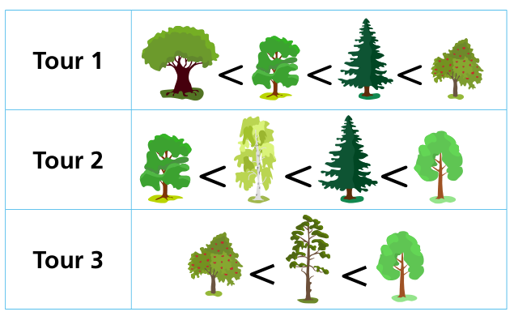

Försterin Flora bietet Baumtouren an. Dabei stellt sie einige Bäume im Wald näher vor. Von drei früheren Touren weiß sie, wie beliebt die Bäume bei ihren Gästen waren.

*Baum 1 < Baum 2* bedeutet, dass Baum 1 weniger beliebt war als Baum 2.

Bei ihren nächsten Touren möchte Flora beliebtere Bäume erst später vorstellen – das Beste kommt zum Schluss. Sie will die Bäume immer in einer guten Reihenfolge vorstellen, die mit der Beliebtheit der Bäume bei allen drei früheren Touren übereinstimmt.

Ein Beispiel: Falls Flora zwei Bäume in einer guten Reihenfolge vorstellen will, von denen auf Tour 1 der eine weniger beliebt war als der andere, dann muss sie den weniger beliebten zuerst vorstellen.

Auf ihrer nächsten Tour möchte Flora die fünf Bäume unten vorstellen: Eiche, hellgrüner Laubbaum, Tanne, Birke und Apfelbaum.

**Bestimme eine gute Reihenfolge dieser Bäume!**
