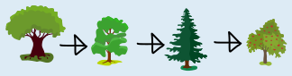
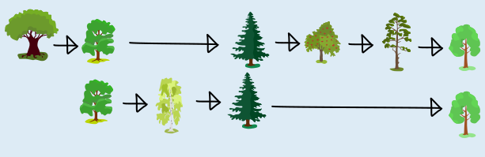
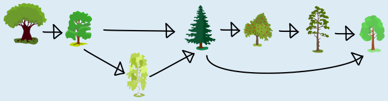

Eine gute Reihenfolge muss mit der Beliebtheit der Bäume bei den drei früheren Touren übereinstimmen. Wenn wir die „Beliebtheitsordnungen“ der drei Touren zu einer Darstellung zusammenfassen, kann sich die Reihenfolge einer neuen Tour nach dieser Darstellung richten.

Diese Darstellung soll ein Diagramm mit Bäumen und Pfeilen sein. Darin werden zwei Bäume immer dann durch einen Pfeil verbunden, wenn ein Baum vor einem anderen Baum vorgestellt werden muss. Für jede frühere Tour lässt sich so ein Diagramm einfach erstellen. Hier das Diagramm für Tour 1:

Das können wir leicht mit dem Diagramm für Tour 3 kombinieren, weil die beiden Touren nur den Apfelbaum gemeinsam haben:

Dieses Diagramm müssen wir nun noch mit dem für Tour 2 (im folgenden Bild unten) kombinieren. Drei von vier Bäumen aus Tour 2 sind bereits vorhanden, nur die Birke kommt neu hinzu:

Wie oben kommt im kombinierten Diagramm jeder Baum nur einmal vor, aber kein Pfeil geht verloren:

Mithilfe des Diagramms können wir die Aufgabe nun ganz einfach lösen: Die Bäume der neuen Tour besuchen wir im Diagramm von links nach rechts, entlang der Pfeile, und erhalten so eine eindeutige gute Reihenfolge, die mit der Beliebtheit der Bäume bei allen früheren Touren übereinstimmt:

## Das ist Informatik!

In dieser Aufgabe soll eine Menge von Bäumen nach aufsteigender Beliebtheit sortiert werden. Es gibt Informationen über einige Bäume, die paarweise in ihrer Beliebtheit verglichen wurden. Für andere Baumpaare, wie beispielsweise Eiche und hellgrüner Laubbaum, gibt es keinen direkten Vergleich. Dennoch können auch diese Bäume verglichen werden. Dabei sind allerdings zwei Eigenschaften von zentraler Bedeutung:

1. Der Beliebtheitsvergleich ist transitiv. Das heißt, falls Baum 1 < Baum 2 und Baum 2 < Baum 3, dann ist auch Baum 1 < Baum 3.
2. Die drei früheren Touren sind nicht im Widerspruch zueinander: Falls in irgendeiner der drei Touren Baum 1 < Baum 2, dann gibt es keine andere Tour mit Baum 2 < Baum 1.

Dank dieser Eigenschaften bilden die Beliebtheitsvergleiche im mathematischen Sinne eine Ordnung. Es mag zunächst den Eindruck haben, dass diese Ordnung partiell ist, da nicht alle Bäume paarweise miteinander verglichen sind. Dennoch lassen sich die Bäume in dieser Biberaufgabe in einer Folge anordnen, die mit der Beliebtheitsvergleichs-Ordnung übereinstimmt; eine solche Folge nennen wir eine topologische Sortierung. Die Informatik kennt einen relativ einfachen Algorithmus, der eine topologische Sortierung bestimmen kann, wenn es in den bekannten paarweisen Vergleichen keine Widersprüche gibt.

Bei näherer Betrachtung kann man feststellen, dass die Beliebtheit der Bäume dank der Transitivität eine totale Ordnung ist. Damit ist die topologische Sortierung aller Bäume eindeutig – was auch die Eindeutigkeit der richtigen Antwort zusätzlich beweist.
