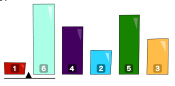
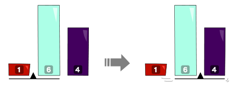
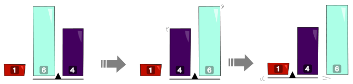

Eine Maschine kann sechs unterschiedlich hohe Bausteine bewegen. Dabei benutzt sie eine Markierung (▲), die in der Regel zwischen zwei Steinen steht. Am Anfang stehen Steine und Markierung so:

Die Maschine arbeitet dann nach diesen Vorschriften:

- Wenn der Stein links von der Markierung kleiner ist als der Stein rechts davon, geht die Markierung nach rechts.

- Wenn der Stein links von der Markierung größer ist als der Stein rechts davon, werden die Steine vertauscht. Danach geht die Markierung nach links – aber nur, wenn sie dann immer noch zwischen zwei Steinen steht.

Die Maschine arbeitet so lange, bis die Markierung ganz rechts neben den Steinen steht. Dann stoppt die Maschine.

**Wie stehen die Steine, nachdem die Maschine stoppt?**
