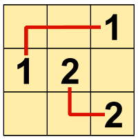
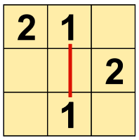

Lasst uns Berukone spielen!

Ein Berukone-Rätsel besteht aus einem Raster mit Zahlen auf den Feldern. Zwei gleiche Zahlen bilden ein Paar.

Um das Rätsel zu lösen, musst du für alle Paare die beiden Zahlen durch eine Linie verbinden. Diese Verbindungslinie muss waagrecht oder senkrecht von Feld zu Feld gehen, darf sich aber auf einem Feld um 90 Grad drehen. Eine Linie darf nicht durch eine andere Zahl und nicht durch eine andere Linie gehen.

Leider gibt es Berukone-Rätsel, die nicht gelöst werden können:

**Dieses Berukone kann gelöst werden.**

**Dieses Berukone kann nicht gelöst werden.**

**Genau eines der Berukones A bis D kann nicht gelöst werden. Welches?**
