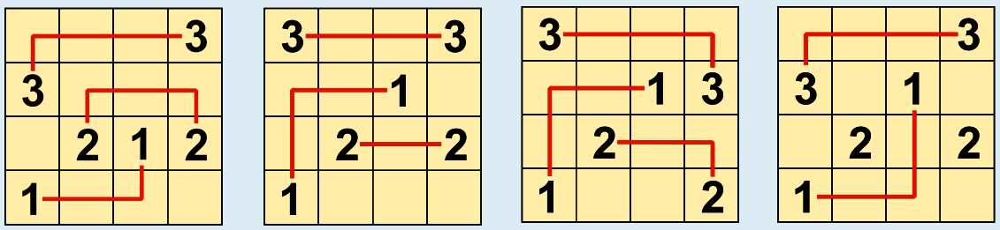

Berukone D ist das einzige der vier Berukone-Rätsel, das nicht gelöst werden kann. So kannst du die Rätsel A, B und C lösen und versuchen Rätsel D zu lösen:

Im Rätsel D gibt es keine Möglichkeit, für alle Paare die beiden Zahlen nach den Berukone-Regeln zu verbinden. Insbesondere kann es nur für eines der beiden Paare aus 1en und 2en eine regelgemäße Verbindungslinie geben: Die einzige Linie, mit der man die 1en verbinden kann, ohne dass die Linie durch eine andere Zahl geht, ist oben dargestellt. Alle möglichen Linien zwischen den 2en, die nicht durch mindestens eine andere Zahl gehen, würden die Linie zwischen den 1en kreuzen. Es gibt also keine Möglichkeit mehr, auch noch die 2en mit einer Linie zu verbinden, ohne die Regeln zu verletzen.

## Das ist Informatik!

Für die kleinen Berukone-Rätsel in dieser Biberaufgabe ist relativ einfach zu erkennen, ob sie gelöst werden können oder nicht und wie sie gelöst werden können. Aber stell dir größere Rätsel vor, mit viel mehr Zahlen: Dann ist es vielleicht nicht mehr so einfach, eine Lösung zu finden. Es könnte viele Möglichkeiten geben, die Paar-Zahlen zu verbinden, und es würde viel Zeit in Anspruch nehmen, alle auszuprobieren.

Aber du kannst versuchen, das schlauer anzugehen. Du kannst Schritt für Schritt vorgehen, wenn du ein Rätsel löst: Verbinde die Paare nacheinander oder versuche, die Rasterfelder nacheinander zu füllen. Sobald du voraussehen kannst, dass dein aktueller Weg nicht mehr zu einer Lösung führt, war mindestens ein vorheriger Schritt falsch. Dann kannst du den letzten Schritt rückgängig machen und vielleicht sogar noch mehr Schritte, bis du zu einer Stelle kommst, an der ein alternativer Schritt möglich ist, der die bessere Wahl sein könnte. Das heißt, du gehst auf der Spur (engl.: track), die du mit deinen bisherigen Schritten gelegt hast, zurück (engl.: back), um dann einen anderen Weg zu verfolgen.

Diese Methode heißt in der Informatik Backtracking. Sie wird oft verwendet, um Computerprogramme Probleme – ob reale Probleme oder nur Rätsel – automatisch lösen zu lassen. Backtracking-Algorithmen funktionieren wie oben beschrieben: Sie versuchen, Lösungen Schritt für Schritt zu konstruieren und Schritte rückgängig zu machen, wenn sie voraussehen können, dass der aktuelle Weg nicht zu einer Lösung führt. Ihre Fähigkeit, (a) gute Entscheidungen beim nächsten Schritt zu treffen und (b) vorauszusehen, ob der aktuelle Weg zu einer Lösung führen kann oder nicht, ist entscheidend für ihren Erfolg. Backtracking-Algorithmen müssen oft mit schwierigen Problemen umgehen, für die spezifische Lösungsansätze nicht bekannt sind. Im Jahr 2010 fanden japanische Forscher heraus, dass das Lösen von Arukone-Rätseln (eine Variante von Berukone, auch bekannt als Numberlink, bei der in einer Lösung kein Feld frei bleiben darf) zu den schwierigsten bekannten Problemen in der Informatik gehört.
