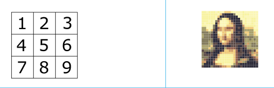
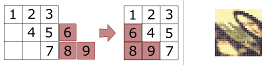
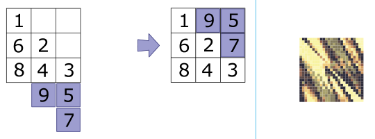
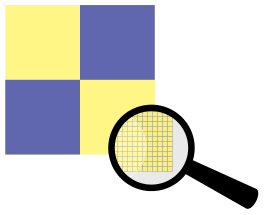

Ein Bild ist ein Rechteck, das sich aus Zeilen und Spalten von Pixeln (Farbpunkten) zusammensetzt.

Leo hat sich ein Verfahren zur Verschlüsselung von Bildern überlegt. Er verwendet dabei diese zwei Operationen:

**Operation H (für horizontal)**

In Zeile 1 bleiben die Pixel unverändert. In Zeile 2 rückt jedes Pixel um 1 nach rechts. In Zeile 3 rückt jedes Pixel um 2 nach rechts. *Jedes Pixel in der n-ten Zeile rückt um n-1 Spalten nach rechts.* Pixel, die dabei über den rechten Bildrand hinausrücken, werden in derselben Zeile links wieder eingefügt. Die Pixelreihenfolge wird dabei nicht verändert.

**Operation V (für vertikal)**

*Jedes Pixel in der n-ten Spalte rückt um n-1 Zeilen nach unten.* Pixel, die über den unteren Bildrand hinausrücken, werden in derselben Spalte oben wieder eingefügt.

Die Operationen können hintereinander durchgeführt werden, als Folge. Im Beispiel hat Leo das Bild (25×25 Pixel) mit der Folge HV verschlüsselt. Unmittelbar oberhalb rechts siehst du das Ergebnis.

Leo verschlüsselt das folgende Bild (1000×1000 Pixel) mit der Folge **VH**:

**Wie sieht das Ergebnis aus?**
