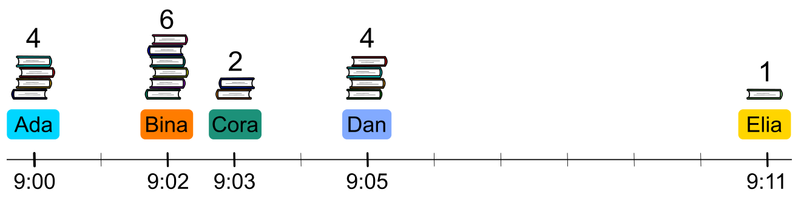

Die Biber in Holzdorf sind fleißige Leserinnen und Leser. In der Bibliothek müssen die Biber deshalb oft warten, wenn sie ihre Bücher zurückgeben wollen.

Wenn ein Biber an der Reihe ist, gibt er alle mitgebrachten Bücher zurück. Die Rückgabe eines Buchs dauert immer genau eine Minute. Ist ein Biber fertig, kommt der nächste Biber aus dem Wartebereich an die Reihe. Das ist immer der Biber mit den wenigsten Büchern.

An einem Morgen kommen nach und nach 5 Biber und wollen ihre Bücher zurückgeben.

Das Bild zeigt für jeden Biber,

- wann er im Wartebereich ankommt und
- wie viele Bücher er mitgebracht hat.

Ada kommt als erste und kann sofort ihre 4 Bücher zurückgeben.

**In welcher Reihenfolge geben die Biber ihre Bücher zurück?**
