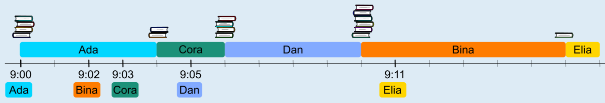

Die Abbildung zeigt, wie die Bücher zurückgegeben werden.

- Zuerst ist Ada an der Reihe, um 09:00 Uhr. Es dauert 4 Minuten, bis sie ihre 4 Bücher zurückgegeben hat. Es ist nun 09:04 Uhr. Erst dann kommt der nächste Biber an die Reihe.

- Inzwischen sind Bina und Cora angekommen und warten. Cora hat 2 Bücher und Bina hat 6. Deshalb ist Cora als nächste an der Reihe. Nach 2 Minuten, um 09:06 Uhr, hat sie ihre Bücher zurückgegeben.

- Inzwischen ist Dan gekommen und wartet zusammen mit Bina. Dan hat 4 Bücher und Bina hat 6. Dan hat am wenigsten Bücher und ist als nächster dran. Nach weiteren 4 Minuten, um 9:10 Uhr, ist auch Dan fertig.

- Nun ist endlich Bina an der Reihe. Bina ist um 9:10 Uhr der einzige Biber im Wartebereich, deshalb hat sie nun die wenigsten Bücher.

- Inzwischen ist Elia gekommen. Wenn Bina um 9:16 fertig ist, ist er der einzige Biber im Wartebereich. Er kommt dann als letzter an die Reihe.

## Das ist Informatik!

Während ein Computer läuft, müssen viele Aufgaben bearbeitet werden. Für jede Aufgabe wird ein Prozess gestartet, der die Aufgabe bearbeitet. Hier kommt der Scheduler ins Spiel. Das ist ein Programm, das zum Betriebssystem eines Computers gehört. Der Scheduler steuert den Ablauf der Prozesse. Er bestimmt, wann und für wie lange ein Prozess von der Zentraleinheit des Computers (CPU) ausgeführt wird. Wenn die CPU gut ausgelastet ist, kann es passieren, dass Prozesse warten müssen. Die Informatik kennt für diesen Fall unterschiedliche Strategien, nach denen Scheduler den nächsten Prozess zur Bearbeitung auswählen; unter anderem:

- Priority Scheduling: Der Prozess mit der höchsten Priorität wird als nächster (vollständig) ausgeführt.

- First Come First Serve (FCFS): Der Prozess, der als erster in die Warteschlange gekommen ist, wird als erster (vollständig) ausgeführt. Nach diesem Prinzip funktionieren die meisten Warteschlangen im Alltag.

- Round Robin: Die wartenden Prozesse werden reihum nur für eine bestimmte Zeit ausgeführt. Wenn ein Prozess dann noch nicht fertig ist, wird er unterbrochen und muss wieder an das Ende der Warteschlange. Dann ist der nächste Prozess an der Reihe.

- Shortest Job First (SJF): Der Prozess mit der kürzesten erwarteten Bearbeitungszeit wird als erster (vollständig) ausgeführt.

In dieser Biberaufgabe verwendet die Bibliothek in Holzdorf bei der Buchrückgabe also die Strategie Shortest Job First: Der Biber mit den wenigsten Büchern (und deshalb der kürzesten Bearbeitungszeit) wird als nächster bedient.
