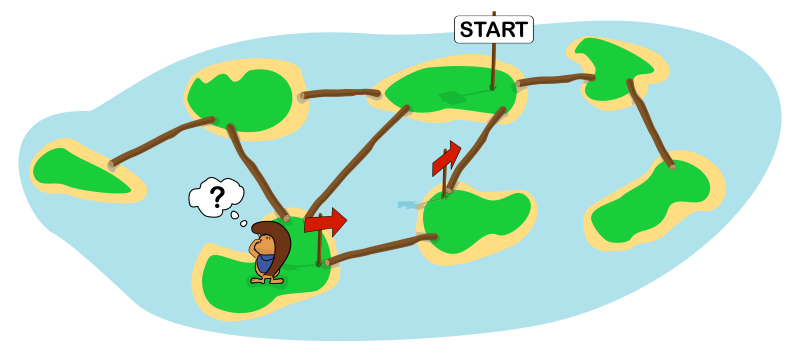

Harry erkundet eine Gruppe von Inseln, die durch Baumstämme verbunden sind. Er hat verschiedene Schilder dabei: ein START-Schild und Pfeile. Wenn Harry sich auf einer Insel befindet, kann er alle damit verbundenen Inseln sehen und feststellen, ob auf ihnen ein Schild steht.

Auf dem Bild hat Harry bereits drei Inseln betreten. Er bewegt sich nach der folgenden Anleitung. Darin ist die „aktuelle Insel“ die Insel, auf der sich Harry gerade befindet, und eine „Nachbarinsel“ ist mit der aktuellen Insel über einen Baumstamm verbunden. Die Anleitung funktioniert, wenn Harry mit ihrer Hilfe jede Insel wenigstens einmal betritt.

Leider hat die Anleitung noch Lücken.

> Betritt eine beliebige Insel, setze dort das START-Schild und erkunde diese Insel.
>
> **Jedes Mal**, wenn du eine Insel erkundest, tue Folgendes:
>
> - **Wenn** auf der aktuellen Insel kein Schild steht, **dann**: Setze einen Pfeil; der Pfeil zeigt zu der Insel, von der aus du die aktuelle Insel betreten hast.
> - **Wenn** es eine Nachbarinsel gibt, auf der **[gelbe Lücke]** steht, **dann**: Betritt diese Insel und erkunde sie.
> - **Sonst**: **Wenn** auf der aktuellen Insel ein Pfeil steht, **dann**: Betritt diejenige Insel, **[grüne Lücke]**, und erkunde sie. **Sonst**: Bleibe stehen. Du hast jede Insel wenigstens einmal betreten.

**Fülle die Lücken mit passenden Textbausteinen, so dass die Anleitung funktioniert.**

Ziehe dazu die Textbausteine in die gelbe und die grüne Lücke der Anleitung.
