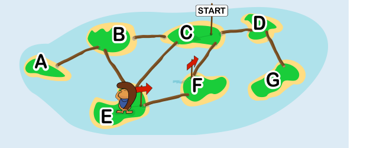
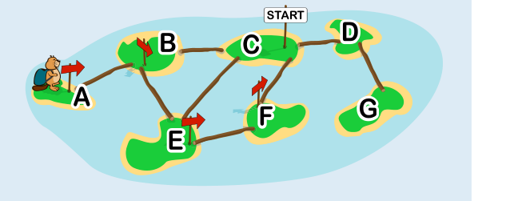
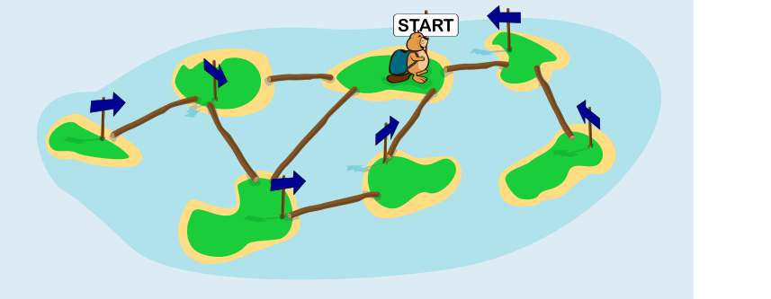

Wir besprechen die beiden Lücken der Anleitung nacheinander.

**Erste, gelbe Lücke:**

Mache dir zunächst Folgendes klar: Harry stellt immer dann ein Schild auf, wenn er eine Insel ohne Schild betritt. Deshalb steht auf allen Inseln, die Harry bereits betreten hat, genau ein Schild und auf allen Inseln, die er noch nicht betreten hat, kein Schild.

Der Text in dieser Lücke bestimmt, wie Harry von einer Insel aus weitergeht. Damit Harry überhaupt alle Inseln betreten kann, muss diese Lücke also „kein Schild“ enthalten. Hier ist ein Beispiel: Harry war schon auf den Inseln C, E, F – dort stehen Schilder. Von E aus geht er zu B, weil dies die einzige Nachbarinsel von E ist, auf der kein Schild steht.

Die Textbausteine „ein Pfeil“ und „ein START-Schild“ sind beide falsch. Wenn Harry auf der ersten Insel entscheiden soll, wie er weitergeht, gibt es nur das START-Schild auf der aktuellen Insel und insbesondere noch keinen Pfeil. Beide Optionen würden also bewirken, dass Harry für immer auf der ersten Insel bleibt.

**Zweite, grüne Lücke:**

Der Text in der Lücke bestimmt, wie Harry sich auf einer Insel verhält, die keine Nachbarinsel ohne Schild hat; er hat dann alle Nachbarinseln bereits betreten. Auf seinem Weg zu dieser Insel hat Harry mit den Pfeilen eine Spur gelegt, und zwar zurück zu der Insel, an der er seine Erkundung gestartet hat. Der Text in der Lücke muss nun dafür sorgen, dass Harry diese Spur zurückverfolgt, bis er auf eine Insel kommt, die Nachbarinseln ohne Schild hat – oder bei der er begonnen hat. Das macht der Textbaustein „auf die der Pfeil zeigt“.

Der Textbaustein „von der du gerade gekommen bist“ ist falsch. Damit könnte Harry für immer zwischen zwei Inseln ohne unbetretene Nachbarinseln hin- und herpendeln.

Hier ist ein Beispiel, siehe Bild: Harry befindet sich auf Insel A, die keine Nachbarinsel ohne Schild hat. Auf der einzigen Nachbarinsel, B, steht ein Schild. Und auch auf jeder Nachbarinsel von B steht je ein Schild. Würde Harry nun immer zu der Insel gehen, „von der er gerade gekommen ist“, würde er für immer zwischen A und B hin und her gehen. Wenn Harry hingegen immer zu der Insel geht, „auf die der Pfeil zeigt“, folgt er den Pfeilen zurück bis Insel C und betritt dann Insel D, weil darauf noch kein Schild steht.

## Das ist Informatik!

Das Netzwerk aus miteinander verbundenen Inseln kann durch einen Graph modelliert werden. Ein Graph ist eine Datenstruktur. Er besteht aus Knoten (hier sind das die Inseln) und Kanten (hier sind das die Baumstämme), die die Knoten verbinden. Viele Systeme der Wirklichkeit können durch Graphen beschrieben werden. Zum Beispiel sind Menschen durch Freundschaften verbunden, Bahnhöfe sind durch Schienenstrecken verbunden, und die möglichen Stellungen eines Schachspiels sind durch gültige Spielzüge verbunden. Manchmal ist es wichtig, einen Graphen vollständig zu durchlaufen, z. B. wenn man einen Knoten mit bestimmten Eigenschaften sucht. Vor allem bei großen Graphen mit vielen Knoten und Kanten braucht man eine Strategie, die sicherstellt, dass man wirklich jeden Knoten besucht und keine Knoten auslässt.

Die Strategie, die in dieser Biberaufgabe beschrieben ist, kennt man in der Informatik als Tiefensuche. Nach der vollständigen Anwendung des Algorithmus auf die Inselgruppe in der Aufgabe ist der Biber wieder auf der Insel, auf der er gestartet ist, und hat so seine Schilder aufgestellt:\n\n
