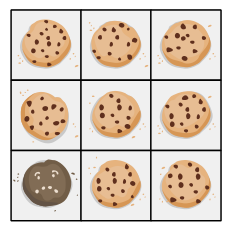
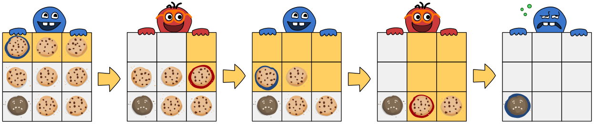

In einer Schachtel sind neun Kekse. Alle sind lecker, bis auf den Frowny unten links.

Cleo und Dan nehmen abwechselnd Kekse aus der Schachtel, bis sie leer ist. Cleo darf immer anfangen.

Man darf die Kekse nur so aus der Schachtel nehmen:

- Man wählt zuerst einen beliebigen Keks aus.
- Dann muss man diesen Keks nehmen und zusätzlich alle Kekse aus dem rechteckigen Bereich **darüber und rechts** davon.

Hier ist ein Beispiel. Der ausgewählte Keks ist jeweils blau oder rot markiert. Dummerweise muss Cleo am Ende den Frowny nehmen, um die Schachtel zu leeren.

Cleos Ziel ist, dass Dan auf jeden Fall den Frowny nehmen muss, egal welche Kekse Dan zwischendurch nimmt. Sie überlegt, welche Kekse sie am Anfang nehmen soll, um ihr Ziel sicher zu erreichen. Auch wenn Cleo zwischendurch weitere Kekse nimmt, verfolgt sie ihr Ziel.

Hier sind vier Möglichkeiten, welche Kekse Cleo am Anfang nehmen kann.

**Mit einer davon kann sie ihr Ziel sicher erreichen. Mit welcher?**
