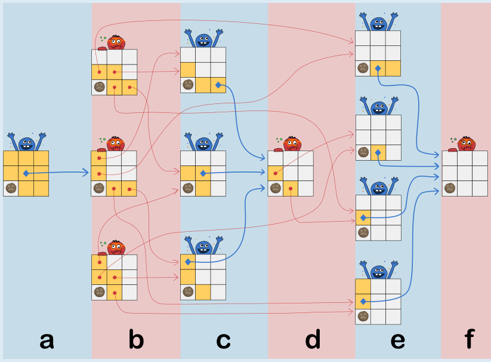

Wenn Cleo die Kekse am Anfang so nimmt, muss Dan auf jeden Fall den Frowny nehmen, und Cleo erreicht sicher ihr Ziel. Bei den anderen drei Möglichkeiten kann Dan einen Weg finden, das zu vermeiden. Zur Erklärung betrachten wir das Kekse-Nehmen wie ein Spiel:

- Wenn Cleo oder Dan Kekse nehmen, machen sie einen Spielzug. Jeder Spielzug ändert die Spielsituation (nämlich welche Kekse wo sind).

- Wenn man am Zug ist und nur noch verlieren kann, ist man in einer Verlustsituation. Das ist auf jeden Fall die Situation, in der nur noch der Frowny in der Schachtel liegt. Das ist aber auch jede andere Situation, in der man den Gegner mit allen möglichen Zügen in eine Gewinnsituation bringt, in der der Gegner mit einem Zug wieder eine Verlustsituation erzeugen kann.

Cleo braucht also in der Startsituation einen Zug, mit dem sie Dan in eine Verlustsituation bringen kann.

Im Bild sind einige Situationen dargestellt und in Bereiche eingeteilt:

- Bereich f zeigt die Verlustsituation, in der nur noch der Frowny in der Schachtel liegt.

- Bereich e zeigt vier Gewinnsituationen, aus denen jeweils ein Zug zur Verlustsituation in f führt.

- Bereich d zeigt eine Verlustsituation, denn beide möglichen Züge führen zu einer Gewinnsituation in e.

- Bereich c zeigt drei Gewinnsituationen: Für jede Situation gibt es einen Zug, der zur Verlustsituation in d führt.

- Bereich b enthält wieder Verlustsituationen: In jeder Situation führen alle möglichen Züge zu den Gewinnsituationen in c und e.

Man kann sich überlegen, dass man von allen weiteren, im Bild nicht gezeigten möglichen Situationen aus mit einem Zug zu einer Verlustsituation kommt. Das Bild zeigt davon in Bereich a nur die Startsituation des Spiels, aus der genau der Zug von Antwort B (und kein anderer) zu einer Verlustsituation führt. Nur mit diesem Zug kann Cleo also ihr Ziel sicher erreichen.

## Das ist Informatik!

Dieses Spiel kann als eine Variante des bekannten Strategiespiels Nim angesehen werden. Im Spiel werden Konzepte aus der Spieltheorie gebraucht. Ein Spielbaum, der alle erdenkliche Züge beschreibt, wäre viel zu groß, um dargestellt zu werden. Nach manchen Spielsituationen verzweigen sich die Wege, nach anderen nicht. Längere Ketten von Spielsituationen ohne Verzweigungen können kompakter dargestellt werden (wie mit dem Pfeil in der obigen Zeichnung). Jedes mal, wenn wir neu anfangen zu spielen und über andere Wege eine vorbemerkte Spielsituation erreichen, können wir direkt nach vorne (d.h. über den Pfeil) springen, ohne weitere Berechnungen vorzunehmen.

Die Idee, Spielsituationen vorzumerken und diese geschickt wiederzuverwenden, ist eine allgemeine Problemlösungsstrategie, die in der Informatik oft verwendet wird und den Namen Dynamische Programmierung trägt.

Mithilfe eines Computers können wir ein Programm schreiben, das diese Strategie umsetzt und das Spiel für ein beliebig großes Spielfeld löst. Das Programm entscheidet in jedem Schritt, welchen Zug eine Spielerin (zum Beispiel Cleo) vornehmen muss, um eine Gewinnsituation zu erzeugen.
