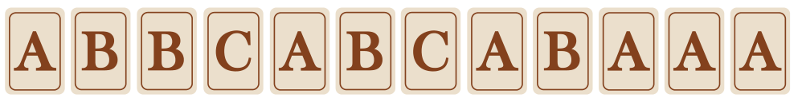

Lege Buchstaben in eine Reihe und bekomme Punkte: Wenn 2 gleiche Buchstaben direkt nebeneinander liegen, bekommst du 2 Punkte, bei 3 gleichen Buchstaben 3, und so weiter.

Ein Beispiel: Die Reihe **B C A C B** bringt 0 Punkte, denn es liegen nirgendwo gleiche Buchstaben direkt nebeneinander.

Nun ersetzt du das erste C durch ein A und das zweite C durch ein B. Das Ergebnis ist **B A A B B**. Dafür bekommst du 4 Punkte: 2 für die beiden A’s und 2 für die beiden B’s hintereinander.

Jetzt hast du eine neue Reihe gelegt, mit 12 Buchstaben. Du kannst darin drei beliebige Buchstaben ersetzen, und zwar durch die Buchstaben B, B und C.

**Ersetze so, dass du für das Ergebnis so viele Punkte bekommst wie möglich. Schreibe die neue Reihe aus 12 Buchstaben ohne Leerzeichen auf.**
