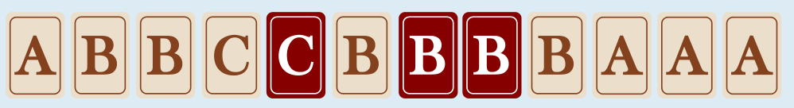

Für diese Reihe bekommst du 2 + 2 + 4 + 3 = 11 Punkte; von links nach rechts liegen 2 B’s, 2 C’s, 4 B’s und 3 A’s in Gruppen hintereinander. Mehr Punkte kannst du nicht bekommen:

- Die Reihe hat 12 Buchstaben. Du könntest also höchstens 12 Punkte bekommen.

- Das A ganz links kann jedoch nicht zu einer Gruppe gehören, denn du hast kein A, um das B rechts daneben zu ersetzen.

- Alle anderen 11 Buchstaben gehören zu einer Gruppe und tragen jeweils 1 Punkt zur Gesamtpunktzahl bei.

Gibt es vielleicht noch andere Ersetzungen, durch die man 11 Punkte bekommen kann? Um möglichst viele Punkte zu bekommen, muss man die Buchstaben B, B und C so in der Reihe platzieren, dass neue Gruppen entstehen und keine bestehende Gruppe aufgelöst oder verkleinert wird:

- Wenn ein Buchstabe passend an eine bestehende Gruppe gelegt wird, dann kommt 1 Punkt hinzu.

- Wenn ein Buchstabe an einen gleichen Einzelbuchstaben gelegt wird, so dass eine neue Gruppe entsteht oder der Einzelbuchstabe an eine bestehende Gruppe angebunden wird, dann kommen 2 Punkte hinzu.

- Wenn ein Buchstabe zwischen zwei gleiche Einzelbuchstaben gelegt wird, dann entsteht eine neue Dreiergruppe, und es kommen sogar 3 Punkte hinzu.

Für die neue Reihe bekommt man ursprünglich 5 Punkte. Mit einer einzelnen Ersetzung durch B, B oder C auf einen Schlag 3 Punkte hinzuzugewinnen, ist nicht möglich. Um auf 11 Punkte zu kommen, müssen also B, B und C so gelegt werden, dass jedes Mal eine neue Zweiergruppe entsteht. Dafür stehen nur zwei Einzel-B’s und zwei Einzel-C’s zur Verfügung:

Es bleibt nur eine Möglichkeit, mit B, B und C drei neue Zweiergruppen zu bilden, ohne die bestehenden Gruppen zu verkleinern:

## Das ist Informatik!

Das Buchstaben-Ersetzungs-Problem in dieser Biberaufgabe ist ein Optimierungsproblem. Es ist nicht irgendeine Ersetzung gesucht, sondern die, mit der sich die höchste Punktwertung erzielen lässt. Diese Ersetzung ist dann eine optimale Lösung des Problems.

Die optimale Lösung muss im Lösungsraum, also in der Menge aller denkbaren „Lösungen“ gesucht werden. In dieser Aufgabe ergibt sich der Lösungsraum aus allen Möglichkeiten, drei Buchstaben der Reihe durch B, B und C zu ersetzen. Da die Reihe zwölf Buchstaben hat, gibt es 12 × 11 × 10 = 1320 Ersetzungsmöglichkeiten, für die jeweils die Punktzahl berechnet und mit den Punktzahlen der anderen Möglichkeiten verglichen werden muss, um die beste Lösung zu bestimmen.

Bei automatischer Verarbeitung durch ein Computerprogramm ist ein Lösungsraum mit 1320 Elementen recht klein. In der Informatik ist es aber immer wichtig zu fragen, wie sich der Lösungsaufwand bei wachsender Problemgröße verhält. Bei längeren Reihen und mehr Ersetzungsbuchstaben ist der Lösungsraum entsprechend größer; bei zum Beispiel einer Reihe mit 20 Buchstaben und 5 Ersetzungsbuchstaben besteht der Lösungsraum schon aus annähernd 2 Millionen Elementen.

Deshalb werden Optimierungsprobleme in der Informatik immer sorgfältig analysiert, um den Lösungsraum möglichst einzuschränken. In dieser Aufgabe kann der Lösungsraum deutlich eingeschränkt werden, wenn man berücksichtigt, dass B, B und C nur dann Punkte erzielen, wenn sie neben den gleichen Buchstaben liegen. Bezieht man zusätzlich ein, dass bestehende Gruppen nicht verkleinert werden sollten, wird der Lösungsraum weiter eingeschränkt. Wenn man auch noch beachtet, dass die Anbindung von Einzelbuchstaben mehr Punkte bringt als die Vergrößerung bestehender Gruppen, dann bleibt nur eine optimale Platzierung übrig.
