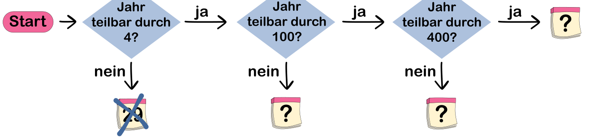

Johanna wurde in einem Schaltjahr an einem 29. Februar geboren. Nur wenn wieder ein Schaltjahr ist, kann sie ihren Geburtstag am 29. Februar feiern. Bisher war das alle vier Jahre. Um schnell bestimmen zu können, ob ein Jahr ein Schaltjahr ist, hat Johanna diesen „Entscheidungsplan“ gemacht:

Nach einiger Zeit lernt Johanna, dass es doch etwas komplizierter ist, ein Schaltjahr zu bestimmen:

- Wenn das Jahr durch 100 teilbar ist, ist es kein Schaltjahr (zum Beispiel 1900).
- Ist das Jahr aber durch 400 teilbar, dann ist es doch ein Schaltjahr (zum Beispiel 2000).

Johanna erweitert ihren Plan und fügt zwei Fragen hinzu. Nur die Entscheidungen sind noch offen: Schaltjahr (Kalenderblatt 29 mit Partyhut) oder nicht (durchgestrichenes Kalenderblatt 29).

**Hilf Johanna und wähle für jedes Fragezeichen die richtige Entscheidung aus.**
