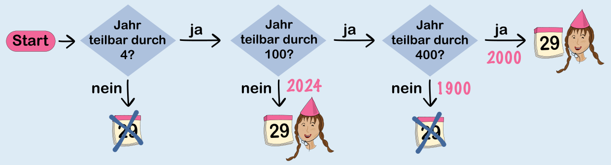

Johannas Entscheidungsplan ist eine andere Darstellung der in der Aufgabe formulierten Regeln für Schaltjahre. Die Fragen, die Johanna ihrem Plan hinzugefügt hat, stellen die neuen Regeln dar, die Johanna später gelernt hat. Wichtig ist, dass die Regel für Jahre, die durch 400 teilbar sind, die Regel für Jahre, die durch 100 teilbar sind, aufhebt. Deshalb hat Johanna die Frage zur „400er-Regel“ auch richtig hinter die Frage zur „100er-Regel“ gesetzt. Beide Fragen werden nur gestellt für Jahre, die durch 4 teilbar sind.

- Die Entscheidung unten Mitte wird also für Jahre getroffen, die durch 4 teilbar sind, aber nicht durch 100; solche Jahre sind dann auch nicht durch 400 teilbar. Die beiden neuen Regeln treffen hier also nicht zu, und es gilt weiter die Regel für Jahre, die durch 4 teilbar sind: Sie sind ein Schaltjahr.

- Die Entscheidung unten rechts wird für Jahre getroffen, die durch 4, durch 100 aber nicht durch 400 teilbar sind. Von den neuen Regeln trifft also nur die 100er-Regel zu: kein Schaltjahr.

- Die Entscheidung ganz rechts wird für Jahre getroffen, die durch 4, 100 und 400 teilbar sind. Hier trifft die 400er-Regel zu: Schaltjahr.

Wir testen den fertigen Plan mit den schon vorher erwähnten Jahren 1900, 2000 und 2024:

1. Das Jahr 2000 ist ein Schaltjahr. 2000 ist durch 4, 100 und 400 teilbar. Im Entscheidungsplan landen wir also bei der Entscheidung ganz rechts: Schaltjahr. Passt!

2. Das Jahr 1900 ist kein Schaltjahr. Weil 1900 durch 4 und durch 100 aber nicht durch 400 teilbar ist, führt der Entscheidungsplan für dieses Jahr zur Entscheidung unten rechts: kein Schaltjahr. Passt auch!

3. Das Jahr 2024 ist ein Schaltjahr. 2024 ist durch 4, aber nicht durch 100 (und damit auch nicht durch 400) teilbar. Der Entscheidungsplan führt für dieses Jahr zur Entscheidung unten mitte: Schaltjahr. Richtig!

## Das ist Informatik!

Mit dem Entscheidungsplan aus dieser Biberaufgabe kann Johanna für jedes Jahr (genauer: für jede Jahreszahl) bestimmen, ob das Jahr ein Schaltjahr ist oder nicht. Der Plan selbst hat einen endlichen Umfang (siehe oben), die Entscheidungsfragen sind eindeutig formuliert und können für jede Jahreszahl beantwortet werden, Johanna kann den Plan für jede Jahreszahl in endlich vielen Schritten bis zu einer Entscheidung durchlaufen, und sie muss sich dafür nur die Zahl selbst merken. Damit hat der Plan alle Eigenschaften eines Algorithmus. Er beschreibt einen Algorithmus, der für eine Jahreszahl entscheidet, ob das Jahr ein Schaltjahr ist oder nicht.

Johanna hat ihren Plan bzw. die Beschreibung ihres Schaltjahr-Entscheidungs-Algorithmus wie einen (einfachen) Programmablaufplan gestaltet. Mittels Programmablaufplänen können Algorithmen beschrieben werden, ohne auf eine bestimmte Programmiersprache zurückgreifen zu müssen. In der Informatik ist es üblich, einen Algorithmus mit einem Programmablaufplan oder auch einem anderen, Programmiersprachen-neutralen Format wie Struktogrammen oder Pseudocode zu beschreiben. Eine solche Beschreibung untermauert, dass das beschriebene Verfahren nicht von technischen Details einer bestimmten Programmiersprache abhängt. Der so beschriebene Algorithmus kann aus dem neutralen Format dann in eine Programmiersprache übersetzt werden.
