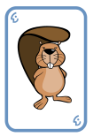
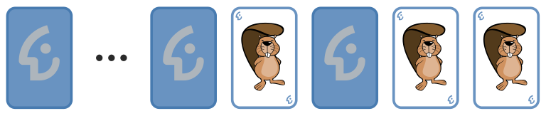
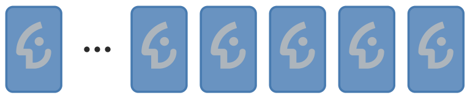

Jemand schenkt dir einen Satz gleicher Karten. Die Karten sehen so aus:

**Aufgedeckt:**  **Verdeckt:** 

Mit diesen Karten kannst du „Drehen“ spielen. Eine Reihe von Karten liegt vor dir. In einem Spielzug gehst du diese Karten von rechts nach links so durch:

- Ist die aktuelle Karte verdeckt, decke sie auf. Damit ist der Spielzug beendet, die übrigen Karten bleiben unverändert.
- Ist die aktuelle Karte aufgedeckt, drehe sie um.

Das Beispiel zeigt, wie sich die Karten in einem Spielzug verändern können:

**Vorher:**

**Nachher:**

- Die beiden rechten Karten sind aufgedeckt und werden umgedreht.
- Die dritte Karte von rechts ist verdeckt und wird aufgedeckt.

Damit ist der Spielzug beendet, die übrigen Karten bleiben unverändert.

Diesmal beginnt das Spiel mit 16 verdeckten Karten.

**Wie viele Karten sind nach 16 Spielzügen aufgedeckt?**
