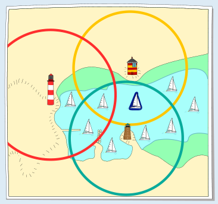
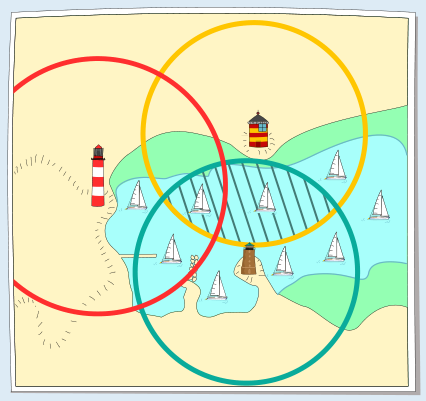
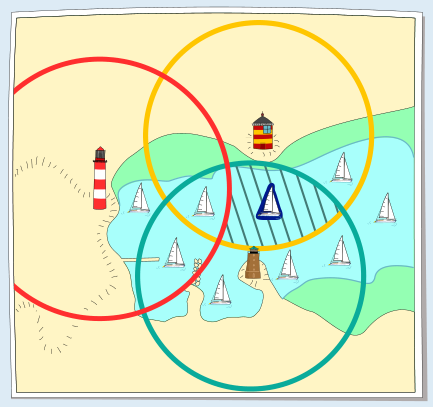

Ben sieht den gelb-rot gestreiften und den braunen Leuchtturm. Bens Boot ist also in dem Gebiet, in dem sich die Kreise dieser Leuchttürme überschneiden.

Ben sieht den rot-weißen Leuchtturm nicht. Also ist Bens Boot nicht im Kreis dieses Leuchtturms.

Dies ist das einzige Boot, das in den beiden Kreisen um den gelb-rot gestreiften und den braunen Leuchtturm ist, aber nicht im Kreis um den rot-weißen. Also ist dieses Boot Bens Boot.

## Das ist Informatik!

In der Informatik ist die exakte Beschreibung eines Problems und des Lösungsverfahrens von großer Bedeutung. Ein nützliches Werkzeug dafür ist die Aussagenlogik, bei der mit Aussagen gearbeitet wird, die jeweils wahr oder falsch sein können. In dieser Biberaufgabe kann ein Gebiet, in dem ein Boot ist, mit diesen drei Aussagen beschrieben werden:

- Aussage A lautet: „Der rot-weiße Leuchtturm ist sichtbar.“
- Aussage B lautet: „Der gelb-rot gestreifte Leuchtturm ist sichtbar.“
- Aussage C lautet: „Der braune Leuchtturm ist sichtbar.“

Für Bens Boot sind die Aussagen B und C wahr, aber die Aussage A ist falsch: Ben sieht den gelb-rot gestreiften und den braunen Leuchtturm, aber nicht den rot-weißen Leuchtturm. In der Aussagenlogik wird das so aufgeschrieben: „B UND C UND NICHT A“.

Diese Aussage kombiniert die „einfachen“ Aussagen A, B und C mit Hilfe von UND und NICHT. Sie beschreibt das in der Erklärung gezeigte Gebiet, in dem genau Bens Boot ist.

In der Karte entspricht zum Beispiel „A UND B UND C“ dem Gebiet, in dem sich alle drei Kreise überschneiden, denn nur dort kann man alle drei Leuchttürme sehen. „NICHT A UND NICHT B UND NICHT C“ entspricht dem Gebiet, das außerhalb der drei Kreise liegt. Dort ist keiner der drei Leuchttürme sichtbar.

In der Informatik kommt die Aussagenlogik unter anderem bei der Wissensrepräsentation, bei der Verifizierung von Programmen und vor allem bei der Modellierung digitaler Schaltungen zur Anwendung.
