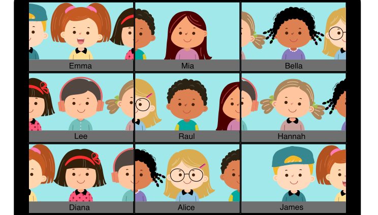

Ava hat die Schule gewechselt. Heute trifft sie ihre Freunde von der alten Schule online. Ihre Freunde sitzen alle nebeneinander in einer Reihe.

Jedes Kind sitzt vor einer eigenen Kamera. In jedem Kamerabild sind aber auch die Kinder zu sehen, die direkt daneben sitzen.

So sieht Ava ihre Freunde auf ihrem Bildschirm:

**Wie sitzen die Freunde nebeneinander in der Reihe?**
