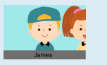
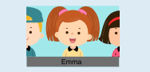
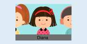
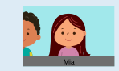
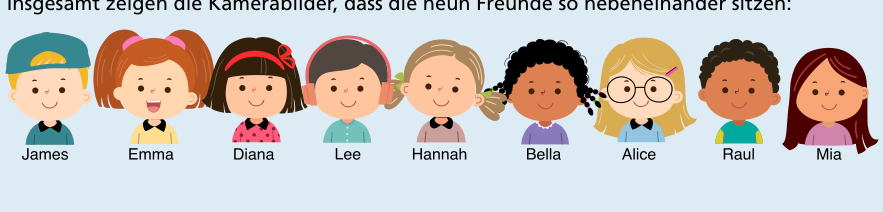
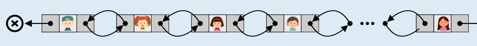

Die Kamerabilder verraten, wer neben wem sitzt.

Im Kamerabild rechts unten auf dem Bildschirm ist links neben James kein Kind zu sehen. Deshalb sitzt James an einem Ende der Reihe. Das Kind, das rechts neben James zu erkennen ist …

… ist im Bild links oben auf dem Bildschirm zu sehen: Emma. Das Kind, das rechts neben Emma zu erkennen ist, …

… ist im Bild links unten zu sehen: Diana. Das Kind, das rechts neben Diana zu erkennen ist, und so weiter … Am Schluss kommt das Kamerabild oben Mitte:

… Mia. Rechts neben Mia ist kein Kind zu sehen. Deshalb sitzt Mia am anderen Ende der Reihe.

Insgesamt zeigen die Kamerabilder, dass die neun Freunde so nebeneinander sitzen:

## Das ist Informatik!

Auf den Kamerabildern sieht man nicht nur ein Kind, sondern kann auch erkennen, welche Kinder links und rechts daneben sind. Informatikerinnen und Informatiker würden sagen: Die Bilder enthalten Verweise auf die Kinder daneben, und die Bilder sind (überwiegend) in zwei Richtungen miteinander verkettet.

Die Kamerabilder in dieser Biberaufgabe bilden aus Informatik-Sicht eine doppelt verkettete Liste. Eine Liste ist allgemein eine Datenstruktur mit Knoten und Verweisen zwischen den Knoten; die Knoten enthalten Daten bzw. Datenelemente. In einer doppelt verketteten Liste enthält jeder Knoten ein Element, einen Verweis auf den vorherigen Knoten und einen Verweis auf den nächsten Knoten. In dieser Aufgabe zeigt jedes Kamerabild (Knoten) das Kind (Element) und Verweise auf die Kamerabilder und damit auch die Elemente rechts und links vom Kind.

Um die richtige Antwort zu finden, durchläufst du die Kinder-Liste und folgst den Verweisen, um die Kinder in die richtige Reihenfolge zu bringen. Im Gegensatz zu der zirkulär verketteten Liste in der Biberaufgabe „Olivers Rassel“ kannst du in beide Richtungen laufen. Es gibt jedoch einen Anfang (Kopf) und ein Ende der Liste. In unserer Liste ist James am Kopf und Mia am Ende der Liste. Ihre Verweise nach links bzw. nach rechts sind leer.\n\n

Ein Beispiel für eine doppelt verkettete Liste ist dein Browser-Verlauf: Du kannst beliebig rückwärts oder dann wieder vorwärts springen. Die aktuell betrachtete Seite (von der aus du im Verlauf zurückgehst), ist am Kopf der Liste.
