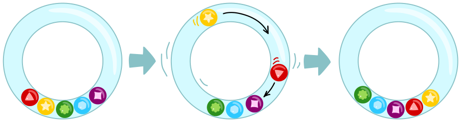
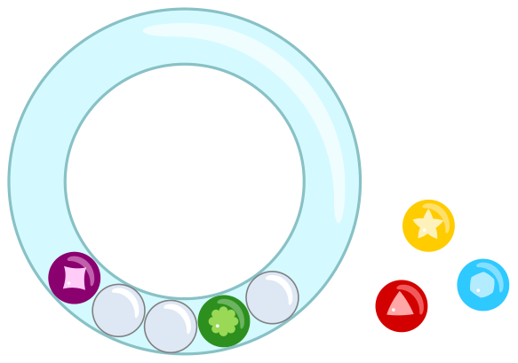

Oliver hat eine durchsichtige Rassel mit bunten Kugeln. Wenn er die Rassel schüttelt, bewegen sich einige Kugeln. Danach liegen die Kugeln anders in der Rassel als vorher.

Oliver schüttelt die Rassel noch einmal.

**Wie liegen die Kugeln nun? Ordne den leeren Plätzen die passenden Kugeln zu.**

(Von links nach rechts liegen unten in der Rassel: violette Kugel, Platz 1, Platz 2, grüne Kugel, Platz 3.)
