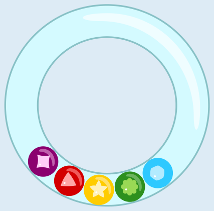
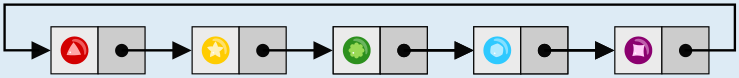

Nach dem Schütteln können die Kugeln anders liegen. Aber ihre Reihenfolge ändert sich nicht: Wenn man von einer bestimmten Kugel aus zur nächsten Kugel geht, ist das immer dieselbe – auch wenn man einmal rundherum durch die Rassel gehen muss.

Schauen wir uns die Reihenfolge im ersten Bild oben an: Nach der roten Kugel kommt die gelbe. Wenn wir das mit einem Pfeil schreiben (rot → gelb), können wir die gesamte Reihenfolge so aufschreiben: rot → gelb → grün → blau → violett.

Nach der violetten Kugel kommt also wieder die rote. So schließt sich der Kreis in Olivers Rassel.

Mit Hilfe der Reihenfolge finden wir leicht die richtige Antwort: Nach der violetten Kugel kommt die rote und danach die gelbe. Die grüne Kugel liegt schon da, und danach kommt die blaue:

## Das ist Informatik!

In Olivers Rassel bleibt die Reihenfolge der Kugeln immer gleich. Egal wo eine Kugel liegt, die nächste Kugel (in einer bestimmten Richtung) ist immer dieselbe. Aber die Kugeln in der Rassel haben noch eine Eigenschaft: Wenn man bei einer Kugel anfängt und zur nächsten Kugel geht und von dort wieder zur nächsten und so weiter, dann kommt man irgendwann wieder bei der Anfangs-Kugel an. Das ist so ähnlich wie bei Perlen an einer Kette, die jemand am Arm oder um den Hals trägt.

Auch in der Informatik kennt man Ketten. Wenn man Datenelemente in einer festen Reihenfolge bearbeiten will, können sie in einer verketteten Liste gespeichert werden. In einer verketteten Liste wird jedes Datenelement in einem eigenen Knoten gespeichert. Zusätzlich enthält jeder Knoten einen Verweis auf den nächsten Knoten in der Liste. Enthält der letzte Knoten einen Verweis auf den ersten Knoten, ist die Kette zirkulär. Die Kugeln in Olivers Rassel bilden so eine zirkuläre verkettete Liste, mit den Kugeln als Knoten und der Nachbarschaft innerhalb der Rassel (gegen den Uhrzeigersinn gesehen) als Verweise:\n\n

Verkettete Listen in Computerprogrammen kommen im Alltag selten zum Vorschein – aber gelegentlich doch: Wenn die Musik-App auf dem Smartphone Songs einer Wiedergabeliste der Reihe nach spielt und am Ende wieder von vorne anfängt, bilden auch die Songs eine zirkuläre verkettete Liste.
