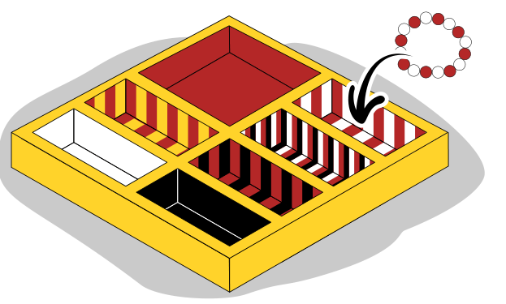

Viktoria hat Armbänder mit farbigen Perlen. Für die Bänder hat sie eine Schachtel mit sieben Fächern. Sie legt ihre Armbänder nur in Fächer mit passendem Farbmuster. Hier ist ein Beispiel für ein Band, das zu einem Fach passt:

**Welches Armband passt zu keinem Fach?**
