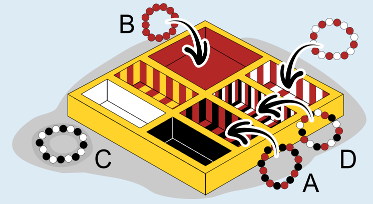

Antwort **C** ist richtig:

Dieses Bild zeigt, zu welchen Fächern die Armbänder A, B und D passen. Das Farbmuster des Fachs passt jeweils zum Farbmuster des Armbands. Es gibt aber kein Fach mit dem Farbmuster schwarz und weiß wie bei Armband C.

## Das ist Informatik!

Viktoria ist ordentlich. Sie legt ihre Armbänder in eine Schachtel mit Fächern. Das Farbmuster eines Fachs muss zu dem Armband passen, das in dieses Fach gelegt wird. So kann Viktoria mit einem Blick jedes Band aus dem richtigen Fach nehmen. Wäre Viktoria weniger ordentlich und würde ihre Armbänder ungeordnet in eine Schublade legen, müsste sie in der Schublade kramen, wenn sie ein bestimmtes Band herausnehmen will. Noch schlechter wäre, wenn in der Schublade auch andere Dinge lägen oder wenn die Bänder in eine große Kiste kämen, die viel mehr Dinge enthalten als eine Schublade.

Computer verwalten viele Daten und legen sie in Speichern mit sehr viel Platz ab. Wenn die Daten ungeordnet in die Speicher kämen, wäre das wie bei einer riesigen Wühlkiste. Es würde dann sehr lange dauern, bestimmte Daten wiederzufinden. Deshalb müssen Informatikerinnen und Informatiker wie Viktoria sein, nämlich sehr ordentlich – zumindest wenn es um die Computerspeicher geht, um die sie sich kümmern. Für Daten gibt es viele verschiedene Ablage-Methoden, mit denen ein Computerprogramm die benötigten Daten schnell finden kann. Am schnellsten geht es mit Hashing: Wenn ein Datenelement gespeichert werden soll, wird ein Wert für das Element berechnet und an eine Stelle im Speicher gelegt, die man mit diesem Wert direkt finden kann. Das ist wie bei Viktoria und der Schachtel mit den Farbmustern in dieser Biberaufgabe.
