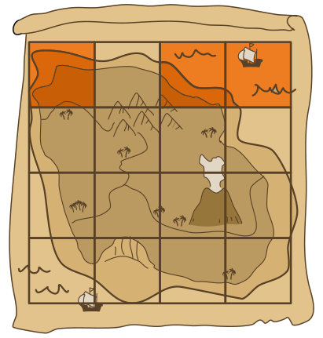

Pip der Pirat sucht einen Schatz auf einer einsamen Insel. Pip hat einen Plan der Insel. Der Plan ist in 16 Quadrate eingeteilt.

Plapper, Pips Papagei, weiß, in welchem Quadrat der Schatz ist. Pip kann Plapper nach einer beliebigen Menge von Quadraten fragen. Plapper sagt ihm dann, ob der Schatz in irgendeinem dieser Quadrate ist oder nicht.

Ein Beispiel: Pip fragt nach den drei Quadraten, die im Bild markiert sind. Wenn Plapper „ja“ sagt, weiß Pip, dass der Schatz in irgendeinem dieser drei Quadrate ist – aber nicht, in welchem.

Pip will so schnell wie möglich sicher wissen, in welchem Quadrat der Schatz ist.

**Wie oft muss Pip dazu mindestens nach Quadraten fragen?**
