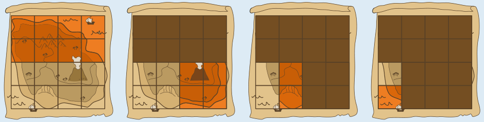

Die richtige Antwort ist **4**.

Um nach vier Fragen sicher zu wissen, in welchem Quadrat der Schatz ist, kann Pip diese Strategie benutzen: Er fragt jeweils genau nach der Hälfte der Quadrate, in denen der Schatz nach den bisherigen Fragen noch sein kann.

Zu Beginn kann der Schatz noch in allen 16 Quadraten sein. In Frage 1 fragt Pip also nach 8 Quadraten davon. Wenn Plapper „ja“ sagt, kann der Schatz in diesen 8 Quadraten sein; wenn Plapper „nein“ sagt, kann der Schatz noch in den anderen 8 Quadraten sein. In Frage 2 fragt Pip dann nach 4 Quadraten aus den übrigen 8, in Frage 3 nach 2 Quadraten aus den übrigen 4 und in Frage 4 nach einem Quadrat aus den übrigen 2. Je nach Antwort auf Frage 4 weiß Pip nun genau, in welchem Quadrat der Schatz ist.

Die Bilder zeigen einen möglichen Verlauf. Pip teilt die übrigen Quadrate jeweils in zusammenhängende Hälften auf. Die angefragten Quadrate sind hellrot markiert. Plapper sagt immer „nein“, und nach vier Fragen weiß Pip, dass der Schatz in dem Quadrat liegt, das im letzten Bild nicht markiert ist.

Mit weniger Fragen kann Pip nicht auskommen. Würde er die übrigen Quadrate nicht in zwei gleich große Hälften einteilen, könnte der Schatz im größeren Teil liegen. Für das Abfragen dieses Teils müsste Pip mindestens genau so oft fragen wie für eine Hälfte.

## Das ist Informatik!

Die Methode, die Pip bei der Schatzsuche anwendet, heißt in der Informatik binäre Suche. Der Begriff binär kommt vom lateinischen Wort „binus“ (deutsch: ein Paar, zwei, zweifach). Bei der binären Suche nach einem Objekt in einer Menge wird die Menge durch eine Reihe von Fragen immer wieder neu halbiert, also in zwei Teile geteilt – deshalb „binär“. Gut halbieren lässt sich eine Menge, wenn die Objekte darin geordnet werden können, z. B. nach Größe; das trifft unter anderem für jede Zahlenmenge zu. Dann gibt es in der Menge ein mittleres Objekt, und man kann das mittlere Objekt mit dem gesuchten vergleichen. Wenn das mittlere Objekt nicht schon das gesuchte ist, weiß man immerhin, in welcher Hälfte der Menge sich das gesuchte Objekt befindet, und durchsucht diese Hälfte wieder binär.

Auf diese Weise kommt man sehr schnell beim gesuchten Objekt an. Bei 1.000 Objekten werden etwa 10 Suchschritte benötigt, bei 1.000.000 Objekten etwa 20. Allgemein kann man sagen: Bei n Objekten werden etwa log(n) Schritte benötigt; die Funktion log ist der „Zweier-Logarithmus“ oder der Logarithmus zur Basis 2. Weil die binäre Suche so schnell ist, wird sie in Computerprogrammen häufig für die Suche in geordneten Daten verwendet.

In dieser Biberaufgabe ist der Suchraum die Menge der Quadrate auf dem Insel-Plan. Die Quadrate kann man ordnen, indem man sie etwa von oben nach unten und von links nach rechts durchnummeriert. Aber in diesem Fall würde es auch funktionieren, die Menge der Quadrate, in denen der Schatz noch sein kann, beliebig zu halbieren. Dann ist es nur etwas aufwendiger sich zu merken, welche Quadrate-Menge für den nächsten Suchschritt noch in Frage kommt und neu halbiert werden muss.
