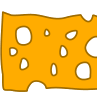

John feiert eine Pizzaparty. Er weiß, welche Beläge sich seine Gäste auf der Pizza wünschen.

| Gast | Wunsch 1 | Wunsch 2 | Wunsch 3 |
|---|---|---|---|
| Alice |  |  |  |
| Bob |  |  |  |
| Cem |  |  |  |
| Dana |  |  |  |

John möchte eine Pizza mit insgesamt drei Belägen backen. Er wählt drei Beläge so aus, dass er möglichst viele Wünsche seiner Gäste erfüllt.

**Mit welchen drei Belägen erfüllt John die meisten Wünsche?**

Ziehe dazu drei Beläge auf die Pizza.
