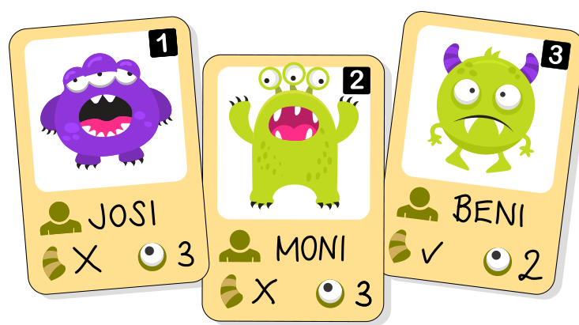

Barbara sammelt Karten mit Monstern, den „Riccas“. Auf jeder Karte sind die Eigenschaften eines Riccas angegeben: der **Name**, die **Anzahl der Augen** und ob das Ricca **Hörner** hat.

Hier sind drei Ricca-Karten, auf denen die Werte der Eigenschaften stehen:

Für jede Eigenschaft ist festgelegt, welche Werte erlaubt sind:

| Eigenschaft | erlaubte Werte |
|---|---|
| Name | Text (mehrere Buchstaben) |
| hat Hörner | ✓ oder X |
| Anzahl der Augen | Zahlen |

Barbara bekommt vier Karten für ein weiteres Ricca. Aber nur auf einer Karte haben alle Eigenschaften erlaubte Werte.

**Auf welcher?**
