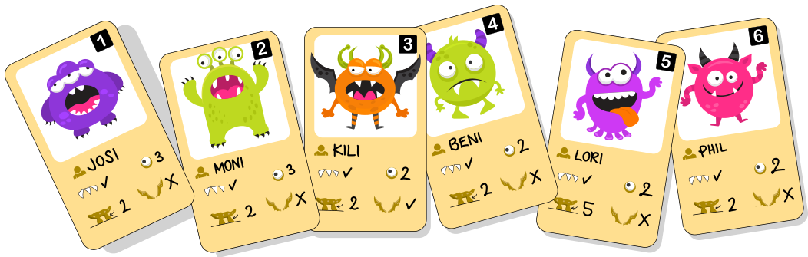
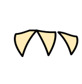

Barbara sammelt Karten mit Monstern, den „Riccas“. Hier sind ihre Ricca-Karten:

Auf jeder Karte sind die Eigenschaften eines Riccas angegeben, zum Beispiel der Name () oder ob das Ricca Zähne hat (). Die Eigenschaften haben Werte. Auf Karte 2 zum Beispiel hat der Name den Wert MONI, und die Eigenschaft Zähne hat den Wert ✓: Das Ricca auf der Karte heißt also MONI und hat Zähne.

Barbara erkennt, dass es nur drei verschiedene Arten von Werten auf den Karten gibt. Sie nennt sie „Typen“:

| Typ | Bedeutung |
|---|---|
| **Text** | mehrere Buchstaben hintereinander |
| **Zahlen** | also 1, 2, 3 usw. |
| **ja/nein** | die Zeichen ✓ und X, die „ja“ und „nein“ bedeuten |

**Ordne den Eigenschaften (Name, Augen, Beine, Flügel, Zähne) die richtigen Typen zu.**
