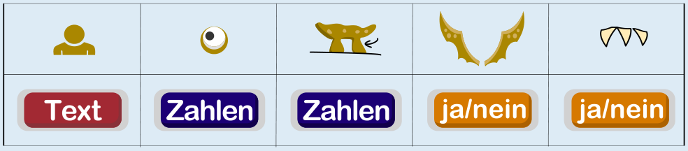

---
answers:
  - { name: text, eyes: num1, legs: num2, wings: yn1, teeth: yn2 }
  - { name: text, eyes: num1, legs: num2, wings: yn2, teeth: yn1 }
  - { name: text, eyes: num2, legs: num1, wings: yn1, teeth: yn2 }
  - { name: text, eyes: num2, legs: num1, wings: yn2, teeth: yn1 }
---
Diese Tabelle enthält für alle sechs Karten die Werte der fünf Eigenschaften:

Aus der Tabelle können wir nun ablesen:

- Alle Werte der Eigenschaft Name sind vom Typ **Text**.
- Alle Werte der Eigenschaften Augen und Beine sind vom Typ **Zahlen**.
- Alle Werte der Eigenschaften Flügel und Zähne sind vom Typ **ja/nein**.

## Das ist Informatik!

Barbara hat festgestellt, dass auf ihren Ricca-Karten verschiedene Typen von Werten verwendet werden. Diese Typen zu unterscheiden, kann bei der Organisation der Karten helfen. Weil Barbara weiß, dass alle Werte der Eigenschaft „Beine“ Zahlen sind, kann sie die Anzahlen der Beine der Riccas miteinander vergleichen und die Karten nach der Anzahl der Beine sortieren.

Eine Ricca-Karte ist wie ein Datensatz, der im Computer gespeichert ist. Die Elektronik von Computer-Speichern kann aber nur 1en und 0en speichern. Auch Computer-Programme verwenden deshalb „Wert-Typen“, die in der Informatik Datentypen heißen, um festzulegen, wie der Computer diese 1en und 0en interpretieren und manipulieren soll. Außerdem kann mit Hilfe von Datentypen geprüft werden, ob und wie gespeicherte Daten miteinander kombiniert werden können.

Die Wert-Typen aus dieser Biberaufgabe entsprechen wichtigen Datentypen aus der Programmierung:

- **Text** wird in Programmiersprachen häufig als „string“ bezeichnet: Daten dieses Typs sind Folgen von Zeichen (Buchstaben, Ziffern und andere Zeichen).
- **Zahlen** entspricht dem Typ „integer“: Daten dieses Typs sind ganze Zahlen, also … -2, -1, 0, 1, 2, … .
- **ja/nein** entspricht dem Typ „boolean“: Dieser Datentyp kennt nur zwei verschiedene Werte, die häufig true und false (wahr und falsch) heißen.
