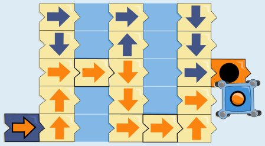
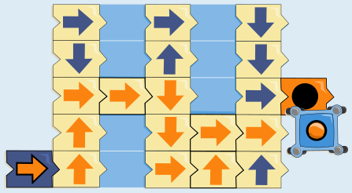
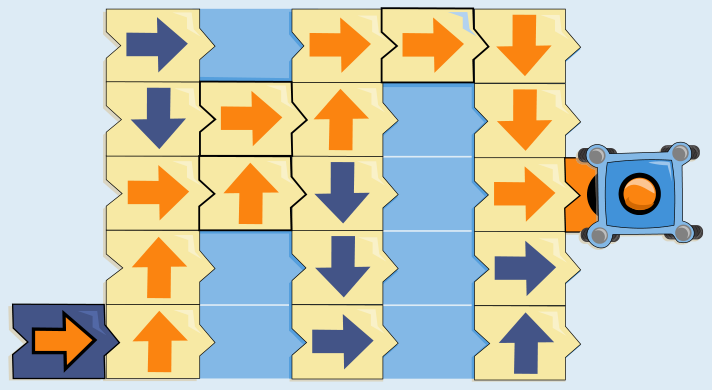

Wie bereits in der Aufgabe angedeutet, wird Robertas Roboter zunächst nach rechts, zweimal hoch und einmal wieder nach rechts fahren. Damit muss ein Kärtchen an die dritte Stelle von oben in der ersten freien Spalte gelegt werden.

Die beiden Arten von Kärtchen, die zur Verfügung stehen, sind „hoch“ (Pfeil nach oben) oder „rechts“ (Pfeil nach rechts). Falls „rechts“ gewählt würde, würde der Roboter also nach rechts fahren, danach zweimal runter und wieder rechts. Nun könnte man entweder wieder „rechts“ oder „hoch“ und darüber „rechts“ wählen. In beiden Fällen würde der Roboter unter dem Ziel landen:

Also muss „hoch“ gewählt werden. Als zweites Kärtchen kann nun nur noch „rechts“ gewählt werden, weil das einzige „hoch“ bereits verwendet wurde. Dann würde der Roboter also nach rechts, hoch, nach rechts und von dort hoch und nach rechts fahren. An dieser Stelle ist das letzte verfügbare Kärtchen „rechts“ zu legen, so dass der Roboter also nach rechts, zweimal runter und einmal nach rechts fahren kann und im Ziel landet.

Es gibt also nur eine richtige Lösung.

Man kann sich diese Lösung übrigens auch schneller rückwärts überlegen: Zum Ziel kommt man nur von den obersten drei möglichen Positionen in der rechten hellblauen Spalte. Dorthin kommt man jedoch nur ganz oben, damit muss ganz oben rechts schon mal „rechts“ liegen. Dorthin kommt man jedoch nur von den obersten beiden Kärtchen in der Mitte, also muss man in der linken hellblauen Spalte noch einmal „rechts“ legen, um dort hinzukommen.

## Das ist Informatik!

In der Regel wird man dieses Problem so lösen wie in der Antworterklärung beschrieben: Man wird mal einen Weg ausprobieren, und wenn er nicht zum Ziel führt, wird man zurückgehen und einen anderen Weg ausprobieren. Dies nennt man in der Informatik eine Tiefensuche, weil zunächst ein Weg vollständig ausprobiert wird und dann erst ein nächster probiert wird. Weil man dazu oftmals einen oder mehrere Schritte zurückgehen muss, um eine andere Lösung auszuprobieren, macht man Backtracking. In jedem Fall jedoch löst man das Problem vorwärts. Manche Probleme jedoch lassen sich besser rückwärts lösen, indem man vom Ziel her schaut, wie man dort hinkommen könnte. Eigentlich ist diese Art von Problem nicht gut geeignet, dass man es rückwärts löst, denn während man vorwärts immer weiß, welches das nächste Kärtchen ist, kann es rückwärts sein, dass man von mehreren Kärtchen kommt (der Pfeil zeigt vorwärts und rückwärts muss man für alle Kärtchen drum herum schauen, ob sie in Richtung des Kärtchens zeigen). Aber in diesem speziellen Fall ist gleichwohl schnell zu erkennen, welche Lösung die einzig richtige sein kann.
