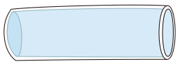
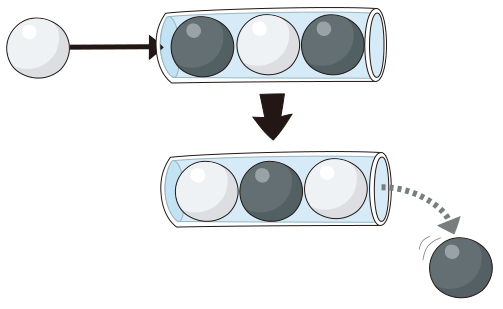
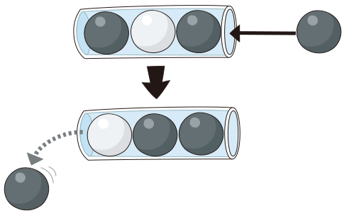
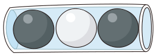
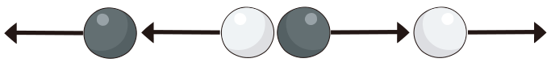

In eine durchsichtige Röhre passen genau drei Kugeln. Die Röhre ist an beiden Seiten offen.

Wenn in die volle Röhre von einer Seite eine Kugel hinein geschoben wird, fällt auf der anderen Seite eine Kugel heraus. Hier sind zwei Beispiele:

**Weiße Kugel von links:** Die Röhre enthält von links nach rechts schwarz, weiß, schwarz. Wird eine weiße Kugel von links hineingeschoben, ist die Röhre danach weiß, schwarz, weiß, und rechts fällt eine schwarze Kugel heraus.

**Schwarze Kugel von rechts:** Wird eine schwarze Kugel von rechts hineingeschoben, ist die Röhre danach weiß, schwarz, schwarz, und links fällt eine schwarze Kugel heraus.

Die Röhre ist mal wieder voll:

Nun werden nacheinander vier Kugeln in die Röhre geschoben: Zuerst eine schwarze und dann eine weiße Kugel von rechts, danach eine schwarze und dann eine weiße Kugel von links:

**Welche drei Kugeln sind am Ende in der Röhre?**

Ziehe dazu schwarze und weiße Kugeln in die Röhre.
