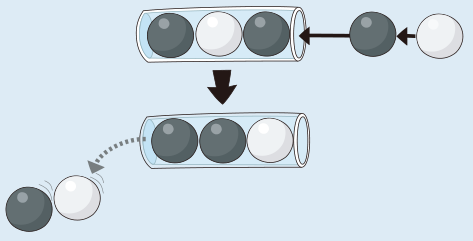
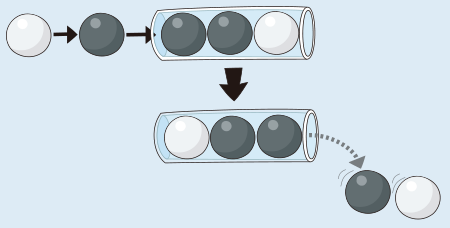

Es werden zwei Kugeln von rechts in die Röhre geschoben, zuerst eine schwarze und dann eine weiße Kugel. Daher fallen links zwei Kugeln raus, zuerst die schwarze, dann die weiße.

Danach werden zwei Kugeln von links in die Röhre geschoben, zuerst eine schwarze und dann eine weiße Kugel. Daher fallen diesmal rechts zwei Kugeln raus, zuerst die weiße, dann die schwarze.

Am Ende sind also (von links nach rechts) eine weiße, eine schwarze und noch eine schwarze Kugel in der Röhre.

Man kann die richtige Antwort auch einfacher bestimmen: Da zuerst von rechts zwei Kugeln in die Röhre geschoben werden und danach von links zwei Kugeln, ist die ursprünglich rechts in der Röhre liegende Kugel wieder rechts. Links davon sind (von rechts nach links) die beiden zuletzt in die Röhre geschobenen Kugeln.

## Das ist Informatik!

Die Röhre in dieser Biberaufgabe ist ein spezielle Form der Warteschlange, die in der Informatik Deque genannt wird (kurz für engl. Double-Ended Queue, „Warteschlange mit zwei Enden“). Im Unterschied zu einer herkömmlichen Warteschlange können wir an beiden Enden einer Deque ein Element hinzufügen und von beiden Enden der Deque ein Element entfernen. Eine Deque ist eine Datenstruktur.

Deques sind vielfältig einsetzbar, z. B. als verallgemeinerter Ersatz sowohl von Stapeln (vorne hinzufügen und vorne entfernen) als auch einfachen Warteschlangen (hinten hinzufügen und vorne entfernen). Man kann sich eine Deque wie ein Rangiergleis vorstellen: vorne und hinten können Waggons an- oder abgehängt werden, aber nicht einfach ein Waggon aus der Mitte herausgenommen werden. Bei einem einfachen Kopfgleis hingegen könnte man nur an einer Seite Waggons an- und abhängen (wie bei einem Stapel) und auf einem so genannten Ablaufberg bewegen sich die Waggons immer nur in einer Richtung (wie bei einer Warteschlange).

So wie die Röhre dieser Aufgabe nur bis zu drei Bälle enthalten kann, hat auch eine Deque praktisch eine begrenzte Kapazität. Wenn einer bereits vollkommen ausgelasteten Deque ein Element hinzugefügt wird, muss am anderen Ende Platz gemacht werden. Dies geschieht, indem dort ein Element entfernt wird und die entsprechende Information verloren geht. Speicherplatz ist eine endliche Ressource und die Menge der Daten, die man speichern kann, hängt davon ab. Gleichwohl werden Deques häufig als hypothetisch unbegrenzt verwendet, insbesondere wenn es eher um theoretische Fragestellungen als um praktische Anwendungen geht.
