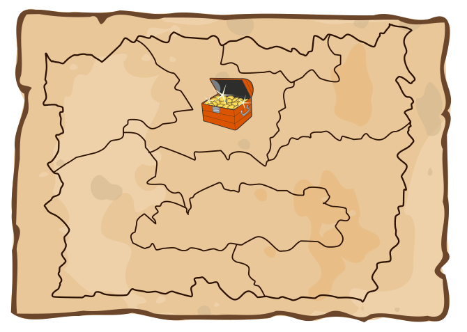

Die Landkarte zeigt das Reich der Biberkönigin mit seinen sieben Provinzen. In einer Provinz hat die Königin ihren Schatz versteckt.

Die Königin will die Lage des Schatzes geheim halten. Deshalb hat sie eine besondere Schatzkarte gezeichnet.

Für jede Provinz ist darin ein Kreis eingezeichnet. Eine Linie zwischen zwei Provinz-Kreisen zeigt, dass die beiden Provinzen aneinander angrenzen. Der Kreis für die Provinz mit dem Schatz ist markiert.

Um mögliche Räuber zu verwirren, hat die Königin zusätzlich vier falsche Schatzkarten gezeichnet.

**Welche ist die richtige Schatzkarte?**
