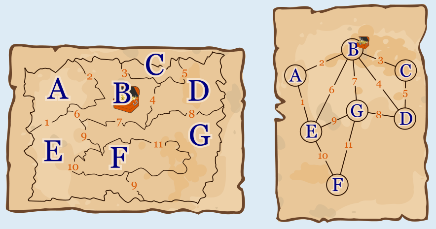

In der Landkarte links sind die Provinzen mit den Buchstaben A bis G gekennzeichnet. Wenn zwei Provinzen aneinander angrenzen, ist ihre gemeinsame Grenze mit einer Zahl bezeichnet; insgesamt mit den Zahlen 1 bis 11. Die Grenze zwischen E und G hat zwei Abschnitte, doch es handelt sich um dieselbe gemeinsame Grenze. Daher sind beide Grenzabschnitte mit der Zahl 9 gekennzeichnet. Indem wir die Buchstaben A bis G und die Zahlen 1 bis 11 in die Schatzkarte D rechts übertragen, erkennen wir, dass diese die richtige Schatzkarte ist.

- Schatzkarte A ist falsch: Die drei Provinzen A, C und F grenzen jeweils nur an zwei andere Provinzen an. Daher muss es auf der richtigen Schatzkarte drei Kreise geben, von denen jeweils genau zwei Linien ausgehen. Es gibt aber nur einen Kreis, von dem genau zwei Linien ausgehen.

- Schatzkarte B ist falsch: Sie hat nur sechs Kreise, es gibt aber sieben Provinzen.

- Schatzkarte C ist falsch: Die Provinz B mit dem Schatz grenzt an die fünf Provinzen A, C, D, E und G an. Also müssen fünf Linien vom markierten Kreis ausgehen, es sind aber nur vier.

- Schatzkarte E sieht der Landkarte am ähnlichsten. Aber auch sie ist falsch, denn auch hier gehen nur vier Linien vom markierten Kreis aus.

## Das ist Informatik!

Die Schatzkarten sind Diagramme, die nur ausgewählte Eigenschaften der Landkarte darstellen. In dieser Biberaufgabe ist die dargestellte Eigenschaft, dass zwei Provinzen aneinander grenzen. Sie wird durch eine verbindende Linie symbolisiert. Vernachlässigt werden die Form dieser Provinzen, die Größe, Lage, Richtungen und Entfernungen. Ein Beispiel: In der Karte grenzt C an die nördlichen Teile von B und D; im Diagramm ist das nicht erkennbar. Um ein Problem mit Hilfe von Computern lösen zu können, wird auch in der Informatik die Realität auf die für die Lösung des Problems wichtigen Eigenschaften reduziert. Informatikerinnen und Informatiker sagen: Zur Modellierung eines Problems wird abstrahiert.

Übrigens: Die Schatzkarten-Diagramme sind so genannte Graphen. Ein Graph besteht aus Knoten und Kanten. Die Knoten stehen für bestimmte Einheiten (hier: die Provinzen), die Kanten repräsentieren Beziehungen zwischen den Einheiten (hier: aneinander grenzen). Graphen können auch noch weitere Eigenschaften haben. Die Graphentheorie, ein Teilgebiet von Mathematik und Informatik, stellt Wissen und Methoden zu Graphen zur Verfügung. Modelliert man ein Problem mit Hilfe von Graphen, kann man darauf zurückgreifen.
