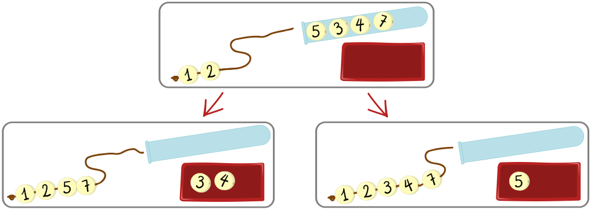

Scott hat Perlen mit Nummern und macht Armbänder daraus. Die Perlen kommen nacheinander aus einem Glasröhrchen. Für jede Perle entscheidet Scott: Entweder verwendet er die Perle fürs Armband und fädelt sie auf die Schnur, oder er legt sie weg.

Scott kann eine Perle nur dann verwenden, wenn

- die Schnur leer ist oder
- die Nummer der Perle größer ist als die Nummer der letzten Perle auf der Schnur.

In diesem Beispiel ist zunächst die **2** die letzte Perle auf der Schnur (im Röhrchen folgen die Perlen 5, 3, 4, 7):

Die nächste Perle (die **5**) kann Scott verwenden, aber auch weglegen. Wenn er

- die 5 verwendet, kann er ein Armband mit vier Perlen machen: 1 2 5 7
- sie weglegt, kann er ein Armband mit fünf Perlen machen: 1 2 3 4 7

Scott bekommt ein neues Röhrchen mit Perlen. Er will daraus ein Armband mit möglichst vielen Perlen machen. Im Röhrchen liegen nacheinander die Perlen **5, 1, 3, 2, 4, 8, 6, 7, 9**.

**Wie kann Scott das schaffen?**

Entscheide für jede Perle, ob sie verwendet oder weggelegt wird. Die Perlen kommen nacheinander aus dem Röhrchen.
