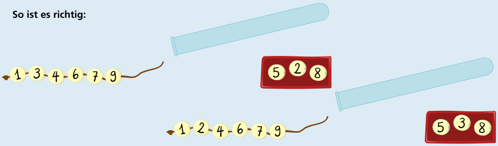
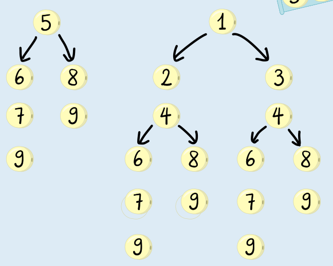

---
answers:
  - ["1", "2", "4", "6", "7", "9"]
  - ["1", "3", "4", "6", "7", "9"]
---
Wir könnten für dieses Röhrchen alle Armbänder auflisten, die Scott aus den Perlen machen kann, und sehen, welche die meisten Perlen haben. Das ist allerdings aufwändig. Schauen wir genauer hin und betrachten nur noch die Nummern auf den Perlen – denn am Ende sind Scotts Armbänder Folgen von aufsteigend sortierten Nummern.

Verwendet Scott die erste Nummer 5 aus dem Röhrchen, kann er danach nur noch 6, 7, 8 und 9 verwenden und die Armbänder 5679 und 589 machen. Wenn Scott die 5 weglegt und die nächste Nummer 1 als erste fürs Armband verwendet, kann er mehr Armbänder mit mehr Perlen machen. Dieser Entscheidungsbaum (siehe Bild) zeigt, wie Scott die Perlen verwenden und welche Armbänder er machen kann: Würde Scott auch die 1 weglegen, kann er nur noch Armbänder machen, die weniger Perlen haben als möglich. Verwendet Scott z. B. die 2 zuerst, kann er u. a. noch die Armbänder 24679 und 2489 machen. Diese sind aber in den Armbändern 124679 bzw. 12489 enthalten, die Scott machen kann, wenn er zuerst die 1 verwendet. Armbänder mit möglichst vielen Perlen beginnen also mit 1 und bestehen aus 6 Perlen: 124679 oder 134679.

## Das ist Informatik!

Jedes Röhrchen in dieser Biberaufgabe enthält eine Folge von nummerierten Perlen, die wir als Folge von Zahlen auffassen können. So wie Scott die Perlen verwendet, ist jedes seiner Armbänder eine aufsteigende Teilfolge der „Röhrchen-Folge“; aufsteigend bedeutet, dass jede Zahl in der Teilfolge (mit Ausnahme der ersten Zahl) größer ist als die Zahl davor. Um ein Armband mit möglichst vielen Perlen zu machen, muss Scott die längste aufsteigende Teilfolge bestimmen. Bei langen Zahlenfolgen würde es sehr viel Zeit benötigen, alle möglichen aufsteigenden Teilfolgen zu bilden, um dann die längste zu bestimmen. Wenn das Röhrchen z. B. 20 Perlen enthält, liegt der Rechenaufwand schon in der Größenordnung von einer Million Arbeitsschritten. Zum Glück hat man in der Informatik Algorithmen entwickelt, die die längste aufsteigende Teilfolge schneller bestimmen können. Dabei wird eine Technik angewendet, die Dynamisches Programmieren heißt. Die Größenordnung des Rechenaufwands liegt bei diesen schnellen Algorithmen für ein Röhrchen mit 20 Perlen unterhalb von hundert Arbeitsschritten.
