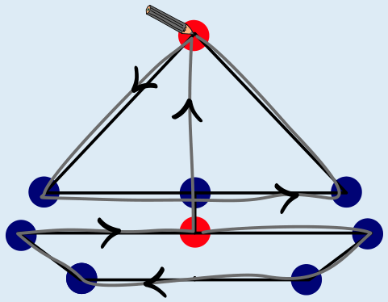

Sophie kann an beiden roten Punkten beginnen. Wenn sie beim unteren roten Punkt beginnt, zeichnet sie zuerst den Rumpf des Bootes nach, danach den Mast und das Segel und kommt schließlich beim oberen roten Punkt an (siehe Bild).

 Beginnt sie beim oberen roten Punkt, kann sie genau umgekehrt vorgehen.

Die beiden Möglichkeiten kann man durch Ausprobieren finden. Man kann aber auch systematisch bestimmen, an welchem Punkt Sophie beginnen kann. Man kann zwischen zwei Arten von Punkten unterscheiden:

- Von den blauen Punkten geht jeweils eine gerade Anzahl Linien aus.

- Von den roten Punkten geht jeweils eine ungerade Anzahl Linien aus.

Sophie kann entweder bei einem blauen oder bei einem roten Punkt beginnen. Wir probieren beide Alternativen aus:

Sophie beginnt bei einem blauen Punkt und zeichnet die erste Linie nach. Um alle von diesem Punkt ausgehenden Linien nachzuzeichnen, muss sie zu diesem Punkt zurückkehren - einmal oder mehrmals. Das ist sicher dann möglich, wenn es nur blaue Punkte gibt: Bei den weiteren blauen Punkten gibt es für jede Linie, über die Sophie beim Nachzeichnen zu diesem Punkt kommt, immer eine noch unbenutzte Linie, über die Sophie den Punkt auch wieder verlassen kann.

Sophie beginnt bei einem roten Punkt. Wegen der ungeraden Anzahl an ausgehenden Linien muss Sophie diesen Punkt irgendwann über die letzte nicht nachgezeichnete Linie verlassen und kann dann nicht mehr zu diesem Punkt zurück. Sie muss also einen anderen Endpunkt finden. Hier bietet sich der zweite rote Punkt an: Wegen der ungeraden Anzahl an Linien kann Sophie diesen Punkt irgendwann nicht mehr verlassen. Es gibt also einen Zusammenhang zwischen den zwei roten Punkten: Sophie muss in einem roten Punkt beginnen und im anderen roten Punkt enden.

Sophie konnte das Segelboot so – also in einem Zug und jede Linie genau einmal – nachzeichnen, weil es genau zwei rote Punkte hat. In der richtigen Antwort müssen beide roten Punkte angegeben sein, obwohl es auch schon eine gute Leistung ist, genau einen richtig zu erkennen.

## Das ist Informatik!

Die Zeichnung vom Segelboot besteht aus Punkten und aus Linien, die einige der Punkte verbinden. In der Informatik sind Strukturen aus Dingen, von denen manche miteinander verbunden sind, als Graph bekannt. Ein Graph besteht aus Knoten und Kanten. Die Segelboot-Zeichnung ist also die Darstellung eines Graphen: Die Punkte sind die Knoten, und die Linien sind die Kanten, die jeweils zwei Knoten miteinander verbinden. Ein Knoten kann mehrere Kanten haben, die von ihm ausgehen, also ihn mit anderen Knoten verbinden. Ein Weg in einem Graphen ist durch eine Folge von Knoten bestimmt und geht über Kanten, die jeweils zwei im Weg aufeinanderfolgende Knoten miteinander verbinden.

In dieser Biberaufgabe will Sophie einen Weg durch den Segelboot-Graphen finden, der durch alle Knoten geht und genau einmal über jede Kante. Die Knoten dürfen dabei beliebig oft besucht werden. Damit das Problem lösbar ist, darf es keine Knoten geben, die man gar nicht erreichen kann. Ein Graph, der diese Voraussetzung erfüllt, ist zusammenhängend. Das Haus vom Nikolaus ist ein bekanntes Rätsel, bei dem man einen solchen Weg in einem zusammenhängenden Graph finden muss.

Der Schweizer Mathematiker Leonhard Euler (1707-1783) hat massgeblich dazu beigetragen, diese Art von Problemen zu verstehen und zu lösen. In Anlehnung an seine Forschungsarbeit ist ein Weg, wie ihn Sophie durch den Segelboot-Graphen finden will, in der Informatik als Eulerweg bekannt. Ein bekannter Algorithmus, der festellt, ob es in einem zusammenhängenden Graphen einen Eulerweg gibt, überprüft, ob ein Graph Knoten mit einer ungeraden Anzahl ausgehender Kanten hat. Einen Eulerweg gibt es in genau zwei Fällen:

- Wenn es genau zwei solcher Knoten gibt, dann startet der Eulerweg in einem dieser Knoten und endet im anderen Knoten.

- Hat ein Graph nur Knoten mit einer geraden Anzahl ausgehender Kanten, dann kann man von jedem Knoten aus einen Eulerweg konstruieren. Alle diese Eulerwege haben eine kreisartige Form, weil sie im selben Knoten starten und enden. In der Informatik redet man dann von einem Eulerkreis. Eulerwege und Eulerkreise haben zahlreiche Anwendungen im alltäglichen Leben. Wenn man einen Spaziergang durch ein Dorf plant, kann man versuchen einen Eulerweg oder einen Eulerkreis zu konstruieren. Findet man einen, dann kann man alle Straßen nacheinander besuchen ohne eine Straße jemals doppelt zu benutzen.
