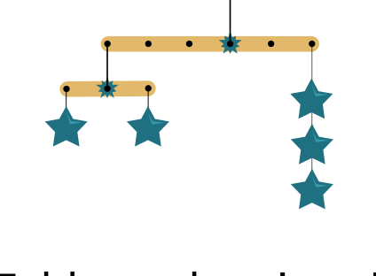

Stern-Mobiles sind Gebilde aus Fäden, Stäben und Sternen. An einem Faden kann eine Anzahl von Sternen hängen; oder ein Stab, an dessen beiden Enden jeweils wieder ein Stern-Mobile hängt.

Dies ist ein einfaches Stern-Mobile:

Mit Zahlen und Klammern kann man es so beschreiben:

`(-3 (-1 1) (1 1)) (2 3)`

Die Zahlen geben jeweils an:

- entweder den Abstand eines Stab-Endes zum Faden, an dem der Stab hängt,
- oder eine Anzahl an Sternen.

Die Klammern geben die Struktur des Stern-Mobiles an.

**Welches der folgenden Stern-Mobiles kann man so beschreiben: `(-3 (-1 4) (2 (-1 1) (1 1))) (2 (-1 6) (2 3))`**
