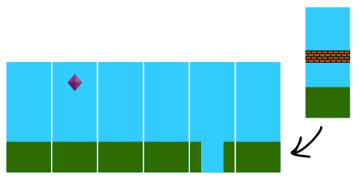

Im Computerspiel „Superbebras“ besteht der Hintergrund aus einer Folge von Kacheln. Der Computer fügt ständig eine neue Kachel auf der rechten Seite der Folge hinzu und entfernt gleichzeitig eine Kachel auf der linken Seite. Das sieht dann wie eine Bewegung aus.

Um die nächste neue Kachel auszuwählen, verwendet der Computer das folgende Diagramm. Im Diagramm sucht er die vorige neue Kachel (auf der rechten Seite) und die Pfeile, die davon ausgehen. Dann wählt er zufällig eine Kachel aus, auf die einer dieser Pfeile zeigt.

Zum Beispiel kann der Computer nach einer Kachel mit Mauer entweder wieder eine Kachel mit Mauer oder eine normale Kachel auswählen.

In einem Superbebras-Hintergrund muss also die Reihenfolge der Kacheln zu obigem Diagramm passen.

**Eines dieser Bilder ist KEIN Superbebras-Hintergrund. Welches?**
