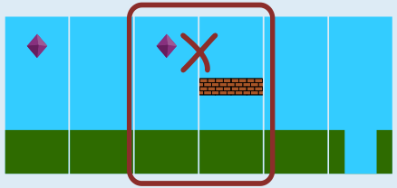

Das Bild aus Antwort C passt nicht zum Diagramm. Auf eine Kachel mit einem Diamanten kann gemäß Diagramm nur eine normale Kachel folgen.

Das ist im Bild aus Antwort C nicht der Fall (markiert):

Alle anderen Bilder passen zum Diagramm.

Es gibt mehrere Möglichkeiten festzustellen, ob ein Bild zum Diagramm passt oder nicht. Ein einfaches Vorgehen besteht darin, die Kacheln des Bildes von links nach rechts durchzugehen und immer zu schauen, ob es für zwei nebeneinander liegende Kacheln einen Pfeil im Diagramm gibt.

Man kann aber auch gezielter vorgehen: Man geht die Kacheln im Diagramm nacheinander durch, beginnend mit den Kacheln, von denen nur ein Pfeil ausgeht. Ein Pfeil ist eine Bedingung: A → B bedeutet „nach Kachel A muss Kachel B kommen“. Dann prüft man, ob das Bild diese Bedingung erfüllt.

## Das ist Informatik!

Einige Computerspiele – wie endlose Läuferspiele – haben einen Hintergrund, der sich horizontal bewegt und die Illusion erzeugt, dass sich der Spieler durch eine Fantasiewelt bewegt. Manchmal ist der Hintergrund kein konstantes Bild, sondern wird automatisch vom Computer erzeugt. Dies nennt man prozedurale Generierung. Üblicherweise werden kleinere Objekte kombiniert, um eine große Vielfalt an Hintergründen zu erzeugen.

Die Kombination der Objekte kann jedoch nicht völlig zufällig erfolgen. Sie muss bestimmten Regeln folgen, um Situationen zu vermeiden, mit denen der Spieler nicht zurechtkommt. In der Aufgabe werden diese Regeln durch ein Diagramm aus Kacheln und Pfeilen dargestellt. Solche Diagramme, in denen Objekte durch Pfeile verbunden sind, kennt die Informatik als gerichtete Graphen (genauer gesagt: als deren grafische Darstellung). Die Objekte werden dann als Knoten und die Pfeile als gerichtete Kanten bezeichnet. Gerichtete Graphen werden in der Informatik zur Modellierung von Zusammenhängen zwischen Objekten verwendet.

Endliche Automaten gehen noch einen Schritt weiter: Sie haben Zustände, einen Startzustand, Endzustände und Regeln, wie man von einem Zustand zum nächsten wechselt. Das ist ähnlich wie bei einem gerichteten Graphen, nur dass es für spezielle Zustände besondere Knoten gibt. Auch ein solcher Automat kann grafisch beschrieben werden, nämlich durch sein Zustandsübergangsdiagramm. Endliche Automaten werden in der Informatik zur Modellierung einfacher Abläufe oder zur Beschreibung einfach konstruierbarer Folgen eingesetzt – wie den Kachelfolgen in dieser Biberaufgabe.
