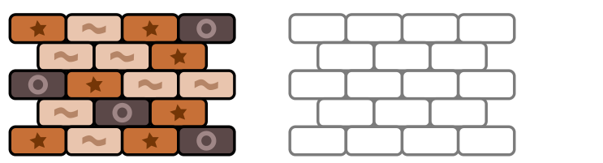

Bob hat einige Ziegelsteine ordentlich gestapelt. Nun soll er den Stapel woanders neu aufbauen. Damit auch der neue Stapel ordentlich wird, arbeitet Bob nach dieser Methode, Stein für Stein, bis alle Steine umgestapelt sind:

- Er nimmt irgendeinen Stein, auf dem kein anderer Stein liegt, vom Stapel und
- legt ihn auf den neuen Stapel, entweder auf den Boden oder auf einen oder zwei andere Steine, keinesfalls aber unter einen anderen Stein.

Links siehst du Bobs ersten Stapel. Rechts ist der Platz für den neuen Stapel.

**Wie kann Bobs neuer Stapel aussehen, wenn er fertig ist?**
